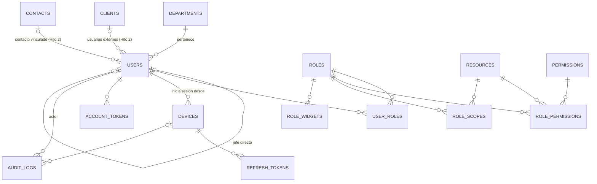

# ERD — Hito 1: Fundaciones

Módulos 01 a 06 del [mapa de módulos](../mapa-de-modulos.md). Convenciones, campos comunes y tipos: [README](README.md). Los campos comunes (`id`, `created_at`, `updated_at`, `version`, `deleted_at`) no se repiten abajo, salvo en las tablas que los varían.

## Diagrama

Entidades sin relaciones (configuración y reglas de una sola fila o sembradas): `company`, `financial_settings`, `security_settings`, `sequences`, `margin_levels`.

---

## 01 Acceso y permisos

### `users`
Usuarios internos y externos (clientes de la empresa, solo lectura). El tipo decide qué perfiles puede tener y si necesita cliente asignado.

| Columna | Tipo | Nulo | Notas |
|---|---|---|---|
| `type` | `ENUM('internal','external')` | no | |
| `name` | `VARCHAR(150)` | no | |
| `email` | `VARCHAR(190)` | no | Inicio de sesión. Único entre activos |
| `active_email` | `VARCHAR(190)` | sí | Generada: `IF(deleted_at IS NULL, email, NULL)`; índice único |
| `password_hash` | `VARCHAR(255)` | sí | `password_hash()` con rehash automático. `NULL` hasta que una invitación fije la contraseña |
| `password_changed_at` | `DATETIME(3)` | sí | Base de la expiración (90 días por defecto) |
| `must_change_password` | `TINYINT(1)` | no | Verdadero tras importar del legacy o crear la cuenta (P20) |
| `failed_attempts` | `TINYINT UNSIGNED` | no | Contador atómico: `UPDATE … SET failed_attempts = failed_attempts + 1` |
| `locked_until` | `DATETIME(3)` | sí | Bloqueo tras los intentos permitidos; al vencer, el contador parte de cero |
| `last_login_at` | `DATETIME(3)` | sí | |
| `department_id` | `BINARY(16)` | sí | FK `departments`. Solo internos. Opcional en la API (el primer administrador no tiene); el formulario web lo pide |
| `manager_id` | `BINARY(16)` | sí | FK `users` (jefe directo). Solo internos. Otro usuario interno activo, sin formar un ciclo (regla en el código) |
| `client_id` | `BINARY(16)` | sí | FK `clients` (Hito 2). Obligatorio para externos: es su alcance de datos |
| `contact_id` | `BINARY(16)` | sí | FK `contacts` (Hito 2). Persona del cliente a la que pertenece la cuenta |

Las FK a `clients` y `contacts` se crean con las migraciones del Hito 2; hasta entonces las columnas existen sin llave. La de `departments` llegó con la rebanada 1.2.
Índices: `uq_users_active_email (active_email)`, `idx_users_department (department_id)`, `idx_users_manager (manager_id)`, `idx_users_client (client_id)`, `idx_users_updated (updated_at)`.

### `roles`
Perfiles (roles) como datos (P5).

| Columna | Tipo | Nulo | Notas |
|---|---|---|---|
| `code` | `VARCHAR(50)` | sí | Solo los perfiles de sistema (`admin`, `external_client`). Único |
| `name` | `VARCHAR(100)` | no | Único entre activos (`active_name`) |
| `description` | `VARCHAR(255)` | sí | |
| `user_type` | `ENUM('internal','external')` | no | Qué tipo de usuario puede tenerlo |
| `is_system` | `TINYINT(1)` | no | Los de sistema no se editan ni se desactivan. El perfil `admin` es inmutable |

### `resources` y `permissions` (tablas de sistema)
Las siembran las migraciones; PK `code`.

| Tabla | Columnas | Ejemplos |
|---|---|---|
| `resources` | `code VARCHAR(50)` PK, `name VARCHAR(100)` | `users`, `roles`, `clients` |
| `permissions` | `code VARCHAR(50)` PK, `name VARCHAR(100)` | `view`, `create`, `edit`, `deactivate` |

Un módulo nuevo exige su `resource` y una migración que lo cree y se lo conceda al perfil `admin` (ADR-0012).

### `user_roles` (unión)
`user_id`, `role_id`. PK compuesta (`user_id`, `role_id`); índice por `role_id`. Sin campos comunes. Un usuario interno puede tener varios perfiles; un externo solo perfiles externos (regla en el código).

### `role_permissions` (unión)
`role_id`, `resource_code`, `permission_code`. PK compuesta de las tres. El `PermissionChecker` niega por defecto: sin fila no hay permiso.

### `role_scopes`
Alcance de datos de un perfil sobre un recurso.

| Columna | Tipo | Notas |
|---|---|---|
| `role_id` | `BINARY(16)` | FK `roles` |
| `resource_code` | `VARCHAR(50)` | FK `resources` |
| `scope` | `ENUM('own','team','all','client')` | `client` solo para perfiles externos |

PK compuesta (`role_id`, `resource_code`). Sin fila se aplica `own`.

### `devices`
Un registro por navegador o dispositivo donde alguien inició sesión.

| Columna | Tipo | Nulo | Notas |
|---|---|---|---|
| `user_id` | `BINARY(16)` | no | FK `users` |
| `platform` | `ENUM('web','android','ios')` | no | |
| `name` | `VARCHAR(100)` | sí | Texto para que el usuario lo reconozca |
| `push_token` | `VARCHAR(512)` | sí | Web Push o push móvil |
| `last_seen_at` | `DATETIME(3)` | sí | |
| `last_sync_at` | `DATETIME(3)` | sí | Hito 8 |
| `revoked_at` | `DATETIME(3)` | sí | Cierra la sesión de ese dispositivo |

Índice `idx_devices_user (user_id)`.

### `refresh_tokens`
Solo se agregan y se revocan; sin `version` ni `deleted_at`.

| Columna | Tipo | Notas |
|---|---|---|
| `device_id` | `BINARY(16)` | FK `devices` |
| `token_hash` | `CHAR(64)` | SHA-256 del token; único. El token en claro no se guarda |
| `expires_at` | `DATETIME(3)` | |
| `revoked_at` | `DATETIME(3)` NULL | Restablecer contraseña o desactivar al usuario revoca todos |

### `account_tokens`
Tokens de un solo uso de los enlaces del correo: invitación de cualquier usuario nuevo (72 h) y recuperación de contraseña (1 h). ADR-0017.

| Columna | Tipo | Notas |
|---|---|---|
| `user_id` | `BINARY(16)` | FK `users` |
| `purpose` | `ENUM('password_reset','invitation')` | |
| `token_hash` | `CHAR(64)` | SHA-256; único |
| `expires_at` | `DATETIME(3)` | 72 horas la invitación, 1 hora la recuperación |
| `used_at` | `DATETIME(3)` NULL | Un `UPDATE … WHERE used_at IS NULL` condicionado lo marca: un solo uso aun con peticiones simultáneas |

---

## 02 Organización

### `departments`

| Columna | Tipo | Notas |
|---|---|---|
| `name` | `VARCHAR(100)` | Único entre activos (`active_name`) |

El jefe directo vive en `users.manager_id`; el departamento no tiene jefe propio. **Equipo** de un usuario (alcance `team`): él mismo, sus subordinados directos e indirectos por `manager_id` y los miembros de su departamento (confirmado en la rebanada 1.2). Un departamento con usuarios activos no se desactiva (`409 department_in_use`, con `active_user_count`).

---

## 03 Configuración general

Tablas de una sola fila (`singleton`, ver README), creadas por la rebanada 1.3 con `id`, `created_at`, `updated_at` y `version` (sin `deleted_at`: no se desactivan). Cada cambio se audita y los límites son del código. El remitente del correo **no** es una tabla: vive en el `.env` ([ADR-0019](../../adr/0019-correlativos-logo-y-remitente.md)).

### `company`
Se siembra vacía: ningún dato de un cliente va en el código.

| Columna | Tipo | Nulo |
|---|---|---|
| `legal_name`, `trade_name` | `VARCHAR(190)` | no (vacío hasta configurarla) |
| `tax_id` (NIT) | `VARCHAR(30)` | no (vacío hasta configurarla) |
| `tax_regime_id` | `BINARY(16)` | sí (FK `tax_regimes`, Hito 2; la columna llega con él) |
| `address`, `phone`, `email` | `VARCHAR(255)` / `VARCHAR(40)` / `VARCHAR(190)` | sí |
| `timezone` | `VARCHAR(50)` | no (`America/Guatemala`). Calendario de los correlativos |
| `logo_path` | `VARCHAR(255)` | sí. `branding/logo-<hash>.webp` bajo `storage/` |

### `financial_settings`

| Columna | Tipo | Valor inicial |
|---|---|---|
| `currency_code` | `CHAR(3)` | `GTQ` (solo lectura, P1) |
| `vat_rate` | `DECIMAL(6,5)` | `0.12000` |
| `income_tax_rate` | `DECIMAL(6,5)` | `0.03000` |
| `stale_cost_days` | `SMALLINT UNSIGNED` | `90` (provisional, `TODO`) |
| `quote_validity_days` | `SMALLINT UNSIGNED` | `15` |

Límites: `0 ≤ vat_rate < 1`, `0 ≤ income_tax_rate < 1` (ADR-0011), `1 ≤ stale_cost_days ≤ 3650`, `1 ≤ quote_validity_days ≤ 365`. La API entrega las tasas como texto (`"0.12000"`), nunca como número de punto flotante.

### `security_settings`
Una sola fila (rebanada 1.5), con `id`, `created_at`, `updated_at` y `version`. Reemplaza las constantes de `SecurityPolicy`; la lee y la edita el módulo `Access` (son sus parámetros y así no depende de `Settings`). Se siembra con los valores de abajo.

| Columna | Defecto | Límite |
|---|---|---|
| `web_idle_minutes` | 30 | 5–1440 |
| `mobile_refresh_days` | 30 | 1–90 |
| `max_failed_attempts` | 3 | 3–20 |
| `lockout_minutes` | 15 | 1–1440 |
| `password_expiry_days` | 90 | 30–365 |
| `password_min_length` | 12 | 12–72, solo sube |

Un cambio aplica desde el siguiente evento que lo lee: las sesiones abiertas conservan el vencimiento con que se emitieron, las contraseñas existentes siguen valiendo con un mínimo mayor y un vencimiento más corto cuenta desde que se fijó la contraseña. Los plazos de los enlaces del correo y la ventana de gracia del refresh no son configurables.

### `sequences` (tabla de sistema)
Numeración única y a prueba de concurrencia (clientes, proveedores, cotizaciones, proyectos, órdenes de compra…). PK `code`. La crea la migración del módulo que emite el documento; la rebanada 1.3 siembra las cinco conocidas.

| Columna | Tipo | Notas |
|---|---|---|
| `code` | `VARCHAR(50)` | `client`, `supplier`, `quote`, `project`, `purchase_order` |
| `name` | `VARCHAR(100)` | Texto para la pantalla |
| `prefix` | `VARCHAR(10)` | Letras y dígitos |
| `padding` | `TINYINT UNSIGNED` | Ceros a la izquierda (no recorta) |
| `period` | `ENUM('none','year','month')` | Cuándo el contador vuelve a 1 |
| `period_key` | `CHAR(4)` NULL | Período del último número: `2026` o `2610` (AAMM) |
| `next_value` | `BIGINT UNSIGNED` | |
| `created_at`, `updated_at`, `version` | | `version` solo cambia al editar la regla, no al emitir |

Reserva atómica en una sola sentencia, dentro de la transacción que crea el documento (ADR-0019): el número vuelve con el rollback, así que **no hay huecos**; el costo es que las altas del mismo tipo hacen cola hasta el commit. El período no cambia una vez emitido un número y el contador solo sube.

---

## 04 Niveles de margen

### `margin_levels`
Niveles de margen de contribución (MC; PM10 «MCP»). El precio de catálogo no se guarda: se calcula con uno de estos niveles (ADR-0011).

| Columna | Tipo | Notas |
|---|---|---|
| `name` | `VARCHAR(60)` | Único entre activos (`active_name`) |
| `rate` | `DECIMAL(6,5)` | `0 ≤ rate < 1` |
| `is_default` | `TINYINT(1)` | |
| `default_marker` | `TINYINT(1)` | Generada: `IF(is_default = 1 AND deleted_at IS NULL, 1, NULL)`; índice único: **un solo nivel por defecto activo** |

El nivel por defecto no se puede desactivar mientras lo sea (`409 default_margin_level`): primero otro pasa a serlo con `set-default`, que mueve la marca en una sola transacción. Los cambios que mueven el default bloquean todas las filas (son pocas), para que dos a la vez no dejen cero ni dos. La rebanada 1.4 siembra «Margen 33 %» (por defecto) y «Margen 35 %». La lista se ordena por margen ascendente (luego nombre); no hay orden manual.

El nivel **no** va en el producto ni en el proveedor: es habitual de cada cliente (`clients.margin_level_id`, Hito 2) y se congela en la línea de cotización (Hito 4).

---

## 05 Auditoría

### `audit_logs`
Solo se agrega: nunca se edita ni se borra. Sin `updated_at`, `version` ni `deleted_at`.

| Columna | Tipo | Nulo | Notas |
|---|---|---|---|
| `occurred_at` | `DATETIME(3)` | no | UTC |
| `user_id` | `BINARY(16)` | sí | FK `users`; `NULL` si lo hizo el sistema o un login fallido |
| `device_id` | `BINARY(16)` | sí | FK `devices` |
| `action` | `VARCHAR(50)` | no | `create`, `update`, `deactivate`, `login`, `logout`, `lockout`, `unlock`, `device_revoke`, … El login fallido no se registra: con correos inventados cualquiera llenaría la tabla; el momento en que una cuenta se bloquea (`lockout`) sí |
| `entity_type` | `VARCHAR(50)` | no | Nombre de la tabla |
| `entity_id` | `BINARY(16)` | sí | Sin FK: apunta a cualquier tabla |
| `entity_label` | `VARCHAR(190)` | sí | El nombre del registro **en el momento de escribir** la entrada (`AuditLogger` lo lee en la misma transacción). Leer el nombre actual reescribiría la historia en un renombre. Solo para tablas con `name` (`AuditEntityLabels`); las filas únicas de configuración no tienen. Las entradas anteriores a la rebanada 1.5c no lo tienen: la API muestra el nombre actual y lo marca (`entity_label_is_current`) |
| `before_data`, `after_data` | `JSON` | sí | Solo los campos que cambiaron; nunca contraseñas ni tokens |
| `ip_address` | `VARBINARY(16)` | sí | `INET6_ATON` |

Índices: `idx_audit_entity (entity_type, entity_id, occurred_at)`, `idx_audit_user (user_id, occurred_at)`, `idx_audit_occurred (occurred_at, id)` (leer del más nuevo al más viejo, rebanada 1.5b).

La lee `GET /v1/audit-logs` (`audit_logs.view`): del más nuevo al más viejo, con filtros y un cursor `(occurred_at, id)` en lugar de páginas, porque la tabla solo crece y un desplazamiento se movería con cada entrada nueva. El alcance del lector se aplica al actor (`user_id`): `own` ve lo que hizo, `all` ve todo, incluido lo que hizo el sistema. Ninguna ruta escribe en ella. **No hay retención ni purga** (nada se borra): deuda a revisar antes de producción.

---

## 06 Dashboard base

### `role_widgets`
Qué widgets ve cada perfil y en qué orden (rebanada 1.5b). Los widgets son código: el catálogo es `WidgetCatalog` (PHP), el enum `WidgetCode` del contrato y el registro de componentes de la web, y una prueba mantiene iguales los dos primeros (el tercero está tipado por el enum). La tabla guarda la asignación y el `widget_code` se valida contra el catálogo. `GET /v1/dashboard` devuelve la unión de los widgets de los perfiles activos del usuario, cada uno una vez, en la posición del perfil que lo pone primero. Un widget nunca lleva datos: los pide con los permisos de quien lo ve. La migración da a todos los perfiles existentes los dos widgets que tenía el inicio, para que nadie vea un cambio al desplegar.

| Columna | Tipo | Notas |
|---|---|---|
| `role_id` | `BINARY(16)` | FK `roles` |
| `widget_code` | `VARCHAR(50)` | |
| `position` | `SMALLINT UNSIGNED` | |

PK compuesta (`role_id`, `widget_code`).

---

## Reglas que el esquema no puede garantizar (van en el código y en tests)
- Un usuario externo solo tiene perfiles externos y siempre un `client_id`; uno interno nunca tiene `client_id`.
- `manager_id` sin ciclos; el último administrador no se desactiva; nadie se desactiva a sí mismo.
- Todo `UPDATE` de una fila con `version` exige la versión leída y la incrementa (`WHERE id = ? AND version = ?`).
- Los límites de tasas y de parámetros de seguridad.
