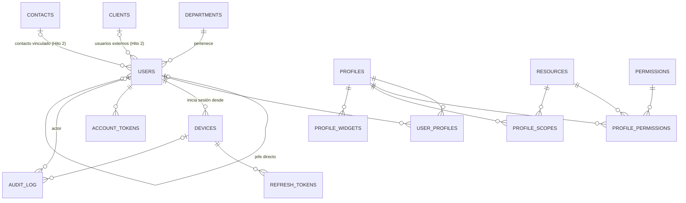

# ERD — Hito 1: Fundaciones

Módulos 01 a 06 del [mapa de módulos](../mapa-de-modulos.md). Convenciones, campos comunes y tipos: [README](README.md). Los campos comunes (`id`, `created_at`, `updated_at`, `version`, `deleted_at`) no se repiten abajo, salvo en las tablas que los varían.

## Diagrama

Entidades sin relaciones (configuración y reglas de una sola fila o sembradas): `company_profile`, `financial_settings`, `security_settings`, `mail_settings`, `number_sequences`, `margin_levels`.

---

## 01 Acceso y permisos

### `users`
Usuarios internos y externos (clientes de la empresa, solo lectura). El tipo decide qué perfiles puede tener y si necesita cliente asignado.

| Columna | Tipo | Nulo | Notas |
|---|---|---|---|
| `type` | `ENUM('internal','external')` | no | |
| `name` | `VARCHAR(150)` | no | |
| `email` | `VARCHAR(190)` | no | Inicio de sesión. Único entre activos |
| `active_email` | `VARCHAR(190)` | sí | Generada: `IF(deleted_at IS NULL, email, NULL)`; índice único |
| `password_hash` | `VARCHAR(255)` | sí | `password_hash()` con rehash automático. `NULL` hasta que una invitación fije la contraseña |
| `password_changed_at` | `DATETIME(3)` | sí | Base de la expiración (90 días por defecto) |
| `must_change_password` | `TINYINT(1)` | no | Verdadero tras importar del legacy o crear la cuenta (P20) |
| `failed_attempts` | `TINYINT UNSIGNED` | no | Contador atómico: `UPDATE … SET failed_attempts = failed_attempts + 1` |
| `locked_until` | `DATETIME(3)` | sí | Bloqueo tras los intentos permitidos; al vencer, el contador parte de cero |
| `last_login_at` | `DATETIME(3)` | sí | |
| `department_id` | `BINARY(16)` | sí | FK `departments`. Obligatorio para internos (regla en el código) |
| `manager_id` | `BINARY(16)` | sí | FK `users` (jefe directo). No puede ser el propio usuario ni formar un ciclo (regla en el código) |
| `client_id` | `BINARY(16)` | sí | FK `clients` (Hito 2). Obligatorio para externos: es su alcance de datos |
| `contact_id` | `BINARY(16)` | sí | FK `contacts` (Hito 2). Persona del cliente a la que pertenece la cuenta |

Las FK a `clients` y `contacts` se crean con las migraciones del Hito 2; hasta entonces las columnas existen sin llave.
Índices: `uq_users_active_email (active_email)`, `idx_users_department (department_id)`, `idx_users_manager (manager_id)`, `idx_users_client (client_id)`, `idx_users_updated (updated_at)`.

### `profiles`
Perfiles (roles) como datos (P5).

| Columna | Tipo | Nulo | Notas |
|---|---|---|---|
| `code` | `VARCHAR(50)` | sí | Solo los perfiles de sistema (`admin`, `external_client`). Único |
| `name` | `VARCHAR(100)` | no | Único entre activos (`active_name`) |
| `description` | `VARCHAR(255)` | sí | |
| `user_type` | `ENUM('internal','external')` | no | Qué tipo de usuario puede tenerlo |
| `is_system` | `TINYINT(1)` | no | Los de sistema no se editan ni se desactivan. El perfil `admin` es inmutable |

### `resources` y `permissions` (tablas de sistema)
Las siembran las migraciones; PK `code`.

| Tabla | Columnas | Ejemplos |
|---|---|---|
| `resources` | `code VARCHAR(50)` PK, `name VARCHAR(100)` | `users`, `profiles`, `clients` |
| `permissions` | `code VARCHAR(50)` PK, `name VARCHAR(100)` | `view`, `create`, `edit`, `deactivate` |

Un módulo nuevo exige su `resource` y una migración que lo cree y se lo conceda al perfil `admin` (ADR-0012).

### `user_profiles` (unión)
`user_id`, `profile_id`. PK compuesta (`user_id`, `profile_id`); índice por `profile_id`. Sin campos comunes. Un usuario interno puede tener varios perfiles; un externo solo perfiles externos (regla en el código).

### `profile_permissions` (unión)
`profile_id`, `resource_code`, `permission_code`. PK compuesta de las tres. El `PermissionChecker` niega por defecto: sin fila no hay permiso.

### `profile_scopes`
Alcance de datos de un perfil sobre un recurso.

| Columna | Tipo | Notas |
|---|---|---|
| `profile_id` | `BINARY(16)` | FK `profiles` |
| `resource_code` | `VARCHAR(50)` | FK `resources` |
| `scope` | `ENUM('own','team','all','assigned_client')` | `assigned_client` solo para perfiles externos |

PK compuesta (`profile_id`, `resource_code`). Sin fila se aplica `own`.

### `devices`
Un registro por navegador o dispositivo donde alguien inició sesión.

| Columna | Tipo | Nulo | Notas |
|---|---|---|---|
| `user_id` | `BINARY(16)` | no | FK `users` |
| `platform` | `ENUM('web','android','ios')` | no | |
| `name` | `VARCHAR(100)` | sí | Texto para que el usuario lo reconozca |
| `push_token` | `VARCHAR(512)` | sí | Web Push o push móvil |
| `last_seen_at` | `DATETIME(3)` | sí | |
| `last_sync_at` | `DATETIME(3)` | sí | Hito 8 |
| `revoked_at` | `DATETIME(3)` | sí | Cierra la sesión de ese dispositivo |

Índice `idx_devices_user (user_id)`.

### `refresh_tokens`
Solo se agregan y se revocan; sin `version` ni `deleted_at`.

| Columna | Tipo | Notas |
|---|---|---|
| `device_id` | `BINARY(16)` | FK `devices` |
| `token_hash` | `CHAR(64)` | SHA-256 del token; único. El token en claro no se guarda |
| `expires_at` | `DATETIME(3)` | |
| `revoked_at` | `DATETIME(3)` NULL | Restablecer contraseña o desactivar al usuario revoca todos |

### `account_tokens`
Tokens de un solo uso para recuperar la contraseña y para las invitaciones de usuarios externos.

| Columna | Tipo | Notas |
|---|---|---|
| `user_id` | `BINARY(16)` | FK `users` |
| `purpose` | `ENUM('password_reset','invitation')` | |
| `token_hash` | `CHAR(64)` | SHA-256; único |
| `expires_at` | `DATETIME(3)` | 1 hora para recuperar contraseña |
| `used_at` | `DATETIME(3)` NULL | Un `UPDATE … WHERE used_at IS NULL` condicionado lo marca: un solo uso aun con peticiones simultáneas |

---

## 02 Organización

### `departments`

| Columna | Tipo | Notas |
|---|---|---|
| `name` | `VARCHAR(100)` | Único entre activos (`active_name`) |

El jefe directo vive en `users.manager_id`; el departamento no tiene jefe propio. **Equipo** de un usuario (alcance `team`): él mismo, sus subordinados directos e indirectos por `manager_id` y los miembros de su departamento. *(Definición propuesta, por confirmar.)*

---

## 03 Configuración general

Tablas de una sola fila (`singleton`, ver README). Cada cambio se audita. Los límites son del código.

### `company_profile`

| Columna | Tipo | Nulo |
|---|---|---|
| `legal_name`, `trade_name` | `VARCHAR(190)` | no |
| `tax_id` (NIT) | `VARCHAR(30)` | no |
| `tax_regime_id` | `BINARY(16)` | sí (FK `tax_regimes`, Hito 2) |
| `address`, `phone`, `email` | `VARCHAR(255)` / `VARCHAR(40)` / `VARCHAR(190)` | sí |
| `logo_path` | `VARCHAR(255)` | sí |

### `financial_settings`

| Columna | Tipo | Valor inicial |
|---|---|---|
| `currency_code` | `CHAR(3)` | `GTQ` |
| `vat_rate` | `DECIMAL(6,5)` | `0.12000` |
| `isr_rate` | `DECIMAL(6,5)` | `0.03000` |
| `stale_cost_days` | `SMALLINT UNSIGNED` | por definir |
| `quote_validity_days` | `SMALLINT UNSIGNED` | `15` |

Límites: `0 ≤ vat_rate < 1`, `0 ≤ isr_rate < 1` (ADR-0011).

### `security_settings`

| Columna | Defecto | Límite |
|---|---|---|
| `web_idle_minutes` | 30 | por definir en el código |
| `mobile_refresh_days` | 30 | por definir en el código |
| `max_failed_attempts` | 3 | |
| `lockout_minutes` | 15 | |
| `password_expiry_days` | 90 | |
| `password_min_length` | 12 | solo se puede subir |

### `mail_settings`
Solo el remitente; las credenciales SMTP viven en el `.env` (ADR-0013).

| Columna | Tipo |
|---|---|
| `from_name` | `VARCHAR(100)` |
| `from_address` | `VARCHAR(190)` |
| `reply_to_address` | `VARCHAR(190)` NULL |

### `number_sequences` (tabla de sistema)
Numeración única y a prueba de concurrencia (proyectos, cotizaciones, OC, clientes, proveedores…). PK `code`.

| Columna | Tipo | Notas |
|---|---|---|
| `code` | `VARCHAR(50)` | `project`, `quote`, `purchase_order`, … |
| `prefix` | `VARCHAR(10)` | |
| `padding` | `TINYINT UNSIGNED` | Ceros a la izquierda |
| `include_year` | `TINYINT(1)` | Si el número lleva el año y se reinicia cada año |
| `year` | `SMALLINT UNSIGNED` NULL | Año del contador actual |
| `next_value` | `BIGINT UNSIGNED` | |

Reserva atómica: `UPDATE number_sequences SET next_value = LAST_INSERT_ID(next_value + 1) WHERE code = ?`, dentro de la transacción que crea el documento. Es única aunque dos peticiones coincidan; si la transacción se revierte puede quedar un hueco (no es consecutiva).

---

## 04 Niveles de margen

### `margin_levels`
Niveles de margen de contribución (MC; PM10 «MCP»). El precio de catálogo no se guarda: se calcula con uno de estos niveles (ADR-0011).

| Columna | Tipo | Notas |
|---|---|---|
| `name` | `VARCHAR(60)` | Único entre activos (`active_name`) |
| `rate` | `DECIMAL(6,5)` | `0 ≤ rate < 1` |
| `is_default` | `TINYINT(1)` | |
| `default_marker` | `TINYINT(1)` | Generada: `IF(is_default = 1 AND deleted_at IS NULL, 1, NULL)`; índice único: **un solo nivel por defecto activo** |
| `sort_order` | `SMALLINT UNSIGNED` | |

El nivel por defecto no se puede desactivar mientras lo sea.

---

## 05 Auditoría

### `audit_log`
Solo se agrega: nunca se edita ni se borra. Sin `updated_at`, `version` ni `deleted_at`.

| Columna | Tipo | Nulo | Notas |
|---|---|---|---|
| `occurred_at` | `DATETIME(3)` | no | UTC |
| `user_id` | `BINARY(16)` | sí | FK `users`; `NULL` si lo hizo el sistema o un login fallido |
| `device_id` | `BINARY(16)` | sí | FK `devices` |
| `action` | `VARCHAR(50)` | no | `create`, `update`, `deactivate`, `login`, … |
| `entity_type` | `VARCHAR(50)` | no | Nombre de la tabla |
| `entity_id` | `BINARY(16)` | sí | Sin FK: apunta a cualquier tabla |
| `before_data`, `after_data` | `JSON` | sí | Solo los campos que cambiaron; nunca contraseñas ni tokens |
| `ip_address` | `VARBINARY(16)` | sí | `INET6_ATON` |

Índices: `idx_audit_entity (entity_type, entity_id, occurred_at)`, `idx_audit_user (user_id, occurred_at)`.

---

## 06 Dashboard base

### `profile_widgets`
Qué widgets ve cada perfil y en qué orden. Los widgets son código (un registro en `shared/`); la tabla guarda la asignación, no el catálogo, y el `widget_code` se valida contra ese registro.

| Columna | Tipo | Notas |
|---|---|---|
| `profile_id` | `BINARY(16)` | FK `profiles` |
| `widget_code` | `VARCHAR(50)` | |
| `position` | `SMALLINT UNSIGNED` | |

PK compuesta (`profile_id`, `widget_code`).

---

## Reglas que el esquema no puede garantizar (van en el código y en tests)
- Un usuario externo solo tiene perfiles externos y siempre un `client_id`; uno interno nunca tiene `client_id`.
- `manager_id` sin ciclos; el último administrador no se desactiva; nadie se desactiva a sí mismo.
- Todo `UPDATE` de una fila con `version` exige la versión leída y la incrementa (`WHERE id = ? AND version = ?`).
- Los límites de tasas y de parámetros de seguridad.
