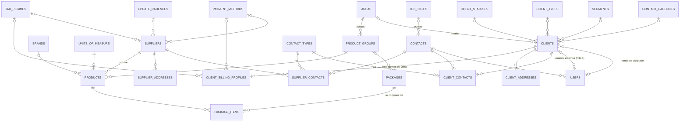

# ERD — Hito 2: Catálogo y clientes

Módulos 07 a 12 del [mapa de módulos](../mapa-de-modulos.md). Convenciones, campos comunes (`id`, `created_at`, `updated_at`, `version`, `deleted_at`) y tipos: [README](README.md). Hito 1: [01-fundaciones.md](01-fundaciones.md).

## Diagrama

Fichas por tema: [catálogos](#07-parámetros-y-08-estructura-del-catálogo), [contactos](#09-contactos), [proveedores](#10-proveedores), [productos y paquetes](#11-productos-y-paquetes), [clientes](#12-clientes).

## Qué completa del Hito 1
Las migraciones de este hito añaden las llaves foráneas que el Hito 1 dejó sin crear: `users.client_id → clients`, `users.contact_id → contacts` y `company_profile.tax_regime_id → tax_regimes`.

---

## 07 Parámetros y 08 Estructura del catálogo

### Catálogos simples
Cada parámetro tiene su propia tabla (ADR-0016) y comparten la misma forma; un solo CRUD genérico en el código los sirve.

| Columna | Tipo | Notas |
|---|---|---|
| `name` | `VARCHAR(100)` | Obligatorio |
| `active_name` | `VARCHAR(100)` | Generada: `IF(deleted_at IS NULL, name, NULL)`; índice único |
| `sort_order` | `SMALLINT UNSIGNED` | Orden de aparición en las listas |

| Tabla | Parámetro | Quién la usa | Valores iniciales |
|---|---|---|---|
| `contact_types` | PM1 Tipo de contacto (el rol de un contacto) | `client_contacts`, `supplier_contacts` | Comercial, Compras, Facturación |
| `client_statuses` | PM2 Estado de cliente | `clients` | ninguno (P3) |
| `contact_cadences` | PM3 Cadencia de contacto | `clients` | ninguno |
| `client_types` | PM4 Tipo de cliente (A-B-C) | `clients` | ninguno |
| `segments` | PM5 Segmentos | `clients` | Restaurantes, Industria Manufacturera, Departamentos/Interiorismo, Construcción, Finanzas, Educación, Servicios, Retail |
| `tax_regimes` | PM6 Régimen fiscal | `clients`, `suppliers`, `company_profile` | ninguno |
| `payment_methods` | PM7 Formas de pago | facturación de clientes, proveedores | ninguno |
| `update_cadences` | PM8 Cadencia de actualización | `suppliers` | ninguno |
| `job_titles` | PM13 Tipo/Puesto | `contacts` | ninguno |
| `units_of_measure` | UFDM (no figura en PM; lo pide el producto) | `products` | ninguno |

`units_of_measure` añade `abbreviation VARCHAR(10)`, también única entre activos.

### Estructura del catálogo
Con relaciones propias, no son catálogos simples.

| Tabla | Columnas propias | Notas |
|---|---|---|
| `areas` (PM9) | `name`, `active_name`, `sort_order` | Valores iniciales: Aire Acondicionado, Electricidad, Cableado, Equipo, Otros |
| `product_groups` (PM12) | `area_id` (FK `areas`), `name` | `name` único dentro de su área entre activos (`active_name` + `area_id`). Un grupo pertenece a un área |
| `brands` (PM11) | `name`, `active_name` | |

PM10 (MCP, margen de productos) es `margin_levels`, ya definido en el Hito 1.

---

## 09 Contactos

### `contacts`
Una persona, independiente del cliente o proveedor al que se vincule.

| Columna | Tipo | Nulo | Notas |
|---|---|---|---|
| `code` | `VARCHAR(30)` | no | Automático (`number_sequences`: `contact`). Único entre activos |
| `name` | `VARCHAR(150)` | no | |
| `job_title_id` | `BINARY(16)` | sí | FK `job_titles` |
| `phone`, `mobile` | `VARCHAR(40)` | sí | |
| `email` | `VARCHAR(190)` | sí | |
| `address` | `VARCHAR(255)` | sí | |
| `zone` | `VARCHAR(100)` | sí | |
| `country_code` | `CHAR(2)` | sí | ISO 3166-1 |

Sincronizable: sí (los vendedores los crean en campo).

### `client_contacts` y `supplier_contacts` (unión con rol)
Un contacto puede tener varios roles ante la misma empresa.

| Columna | Notas |
|---|---|
| `client_id` / `supplier_id` | FK |
| `contact_id` | FK `contacts` |
| `contact_type_id` | FK `contact_types`: el rol (comercial, compras, facturación…) |

PK compuesta de las tres columnas. Sin campos comunes.

---

## 10 Proveedores

### `suppliers`

| Columna | Tipo | Nulo | Notas |
|---|---|---|---|
| `code` | `VARCHAR(30)` | no | Automático (`supplier`). Único entre activos |
| `trade_name` | `VARCHAR(190)` | no | Nombre comercial |
| `legal_name` | `VARCHAR(190)` | sí | Razón social |
| `tax_id` | `VARCHAR(30)` | sí | NIT normalizado y validado ([ver validación](#validación-del-nit)) |
| `active_tax_id` | `VARCHAR(30)` | sí | Generada: `IF(deleted_at IS NULL, tax_id, NULL)`; índice único: un NIT identifica a un solo proveedor activo |
| `tax_regime_id` | `BINARY(16)` | sí | FK `tax_regimes` |
| `payment_method_id` | `BINARY(16)` | sí | FK `payment_methods` |
| `credit_days` | `SMALLINT UNSIGNED` | sí | Términos de crédito |
| `credit_limit` | `DECIMAL(14,2)` | sí | |
| `update_cadence_id` | `BINARY(16)` | sí | FK `update_cadences`: cada cuánto actualiza sus precios |

### `supplier_addresses`
Un proveedor tiene varias direcciones.

| Columna | Tipo | Notas |
|---|---|---|
| `supplier_id` | `BINARY(16)` | FK |
| `label` | `VARCHAR(60)` | «Fiscal», «Bodega»… |
| `line` | `VARCHAR(255)` | |
| `zone` | `VARCHAR(100)` NULL | |
| `country_code` | `CHAR(2)` NULL | |
| `is_primary` | `TINYINT(1)` | Una principal por proveedor (regla en el código) |

El proveedor no tiene margen: el MCP (nivel de margen) se aplica al producto cuando se vende a un cliente, no depende de quién lo vende a la empresa.

**Cascada al desactivar** (regla en el código, auditada): al desactivar un proveedor se desactivan sus productos. Las ofertas cerradas conservan su histórico; si el producto estaba en una oferta vigente, se notifica al responsable (Hito 4).

---

## 11 Productos y paquetes

### `products`

| Columna | Tipo | Nulo | Notas |
|---|---|---|---|
| `code` | `VARCHAR(30)` | no | Automático (`product`). Único entre activos |
| `description` | `VARCHAR(255)` | no | |
| `supplier_id` | `BINARY(16)` | no | FK `suppliers` |
| `group_id` | `BINARY(16)` | no | FK `product_groups`. **El área sale del grupo**: no se guarda en el producto para no duplicarla |
| `brand_id` | `BINARY(16)` | sí | FK `brands` |
| `unit_id` | `BINARY(16)` | no | FK `units_of_measure` |
| `cost` | `DECIMAL(14,4)` | no | **Con IVA**, el de la factura del proveedor (ADR-0011) |
| `cost_updated_at` | `DATETIME(3)` | no | Última modificación del costo. La alerta de «costo desactualizado» compara con `financial_settings.stale_cost_days` |
| `allow_without_stock` | `TINYINT(1)` | no | Permite crear y cotizar sin existencia |

**No se guarda ningún precio.** Sin IVA y con IVA se calculan desde `cost`, un nivel de margen, el IVA y el ISR (ADR-0011, ADR-0014). Índices: `uq_products_active_code`, `idx_products_supplier`, `idx_products_group`, `idx_products_brand`, `idx_products_updated`. Sincronizable: sí.

### `packages`
Ítem compuesto. Es un ítem aparte, no un producto con una marca: no tiene proveedor ni costo propios.

| Columna | Tipo | Nulo | Notas |
|---|---|---|---|
| `code` | `VARCHAR(30)` | no | Automático (`package`). Único entre activos |
| `description` | `VARCHAR(255)` | no | |
| `group_id` | `BINARY(16)` | sí | FK `product_groups`, solo para clasificar |

### `package_items` (unión)
| Columna | Tipo | Notas |
|---|---|---|
| `package_id` | `BINARY(16)` | FK `packages` |
| `product_id` | `BINARY(16)` | FK `products`. Solo productos simples: sin paquetes anidados (P18) |
| `quantity` | `DECIMAL(12,3)` | Mayor que cero (validado en el código) |

PK compuesta (`package_id`, `product_id`). El precio del paquete es la suma de los precios de sus componentes, **calculada** en el momento: sin descuento propio (P17). Dentro de una oferta vigente el precio queda congelado (Hito 4).

---

## 12 Clientes

### `clients`
Un solo registro nace como prospecto y pasa a cliente de venta sin duplicarse; lo propio de la venta (datos fiscales y crédito) vive en `client_billing_profiles`.

| Columna | Tipo | Nulo | Notas |
|---|---|---|---|
| `code` | `VARCHAR(30)` | no | Automático (`client`). Único entre activos |
| `kind` | `ENUM('prospect','customer')` | no | |
| `trade_name` | `VARCHAR(190)` | no | Nombre de la empresa |
| `seller_id` | `BINARY(16)` | sí | FK `users`: vendedor asignado, responsable total de la relación. Es la referencia del alcance `own` |
| `status_id` | `BINARY(16)` | sí | FK `client_statuses` (P3) |
| `client_type_id` | `BINARY(16)` | sí | FK `client_types` |
| `segment_id` | `BINARY(16)` | sí | FK `segments` |
| `contact_cadence_id` | `BINARY(16)` | sí | FK `contact_cadences` |
| `area_id` | `BINARY(16)` | sí | FK `areas`: área de interés |
| `converted_at` | `DATETIME(3)` | sí | Cuándo pasó de prospecto a cliente |

La conversión es manual hasta el Hito 4 y automática al aceptar la primera cotización. Reasignar la cartera cambia `seller_id` y queda en la auditoría. Índices: `uq_clients_active_code`, `idx_clients_seller (seller_id)`, `idx_clients_kind`, `idx_clients_updated`. Sincronizable: sí.

### `client_billing_profiles`
Existe solo para clientes de venta (relación 1 a 1 con `clients`).

| Columna | Tipo | Nulo | Notas |
|---|---|---|---|
| `client_id` | `BINARY(16)` | no | FK `clients`. Único |
| `legal_name` | `VARCHAR(190)` | no | Nombre fiscal |
| `tax_id` | `VARCHAR(30)` | no | NIT normalizado y validado ([ver validación](#validación-del-nit)) |
| `active_tax_id` | `VARCHAR(30)` | sí | Generada: `IF(deleted_at IS NULL, tax_id, NULL)`; índice único: **el NIT no se repite entre clientes activos** |
| `tax_regime_id` | `BINARY(16)` | sí | FK `tax_regimes` |
| `payment_method_id` | `BINARY(16)` | sí | FK `payment_methods` |
| `credit_days` | `SMALLINT UNSIGNED` | sí | |
| `credit_limit` | `DECIMAL(14,2)` | sí | |

El historial de ventas, los tickets y los contratos no son columnas: se consultan desde sus propias tablas.

### `client_addresses`
Misma forma que `supplier_addresses` (`client_id`, `label`, `line`, `zone`, `country_code`, `is_primary`), más `is_billing TINYINT(1)` para la dirección de facturación. Sincronizable: sí.

---

## Validación del NIT

Un NIT identifica a una sola persona o entidad, así que no se repite. Se **normaliza** (sin guiones ni espacios, mayúsculas) y se **valida con el dígito verificador** de la SAT: módulo 11 ponderado. El último carácter es el verificador y puede ser un dígito o la letra `K`.

1. Con los dígitos sin el verificador, de derecha a izquierda, se multiplican por 2, 3, 4, … y se suman.
2. `verificador = (11 − suma mod 11) mod 11`; si da `10`, es `K`.

| NIT | Resultado |
|---|---|
| `576937-K` | válido (suma 166, 166 mod 11 = 1, 11 − 1 = 10 → K) |
| `8977112-0` | inválido (le corresponde 5) |

El servidor valida (PHP) y `shared/` repite la regla solo para dar aviso en pantalla; ambos se prueban con los mismos vectores, como en el ADR-0014. La fórmula reproduce los dos ejemplos publicados por python-stdnum; **falta confirmarla contra la consulta oficial de la SAT** con NIT reales de la empresa.

## Reglas que el esquema no puede garantizar (van en el código y en tests)
- Un cliente `customer` tiene siempre su `client_billing_profile`; uno `prospect`, no.
- El grupo de un producto, y el de un paquete, deben estar activos; el área de un grupo también.
- Cascada de desactivación de proveedor a productos, y notificación si el producto está en una oferta vigente.
- Una dirección principal por cliente y por proveedor.
- Normalizar y validar el NIT antes de guardar y comparar ([validación](#validación-del-nit)).
- Alcance `own` de clientes por `seller_id`; los usuarios externos solo ven su `client_id`.

## Preguntas abiertas de este hito

| Pregunta | Supuesto | Si cambia |
|---|---|---|
| **P3** Estados reales del cliente | `client_statuses` sin valores fijos | Solo datos |
| **P17 / P18** Descuento y anidación de paquetes | Sin descuento propio, sin anidados | Migración en `package_items` |
| **CUI como NIT**: desde 2023 los NIT de personas se derivan del CUI y la SAT acepta el CUI de 13 dígitos en las facturas | `tax_id` solo acepta NIT con dígito verificador | Se amplía la validación (con FEL, P1, Hito 6) |
| **Consumidor final («CF»)** | No es un cliente: la factura a «CF» no necesita un registro de cliente | Se define con la facturación (Hito 6) |
| Precisión de `cost` | `DECIMAL(14,4)` | Migración |
