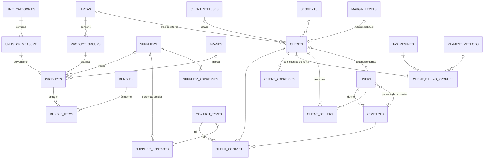

# ERD — Hito 2: Catálogo y clientes

Módulos 07 a 12 del [mapa de módulos](../mapa-de-modulos.md). Convenciones, campos comunes y tipos: [README](README.md). Los campos comunes (`id`, `created_at`, `updated_at`, `version`, `deleted_at`) no se repiten abajo, salvo en las tablas que los varían. Las columnas de contacto, crédito y producto son un supuesto hasta ver el legacy (P23): cualquier ajuste es una migración aditiva.

Decisiones que sustentan este modelo: [ADR-0022](../../adr/0022-identificacion-fiscal.md) (identificación), [ADR-0023](../../adr/0023-desactivacion-referencias-y-cascada.md) (desactivación), [ADR-0024](../../adr/0024-permisos-por-seccion-y-listas-de-opciones.md) (permisos) y [ADR-0025](../../adr/0025-clientes-con-varios-asesores-y-contactos-propios.md) (clientes y contactos).

## Diagrama

---

## 07 Parámetros de catálogo

Cinco tablas con la misma forma (ADR-0016): una tabla por parámetro y un solo código genérico que las sirve.

| Tabla | Parámetro | Columnas propias | Siembra |
|---|---|---|---|
| `contact_types` | PM1 | — | Comercial, Compras, Facturación |
| `client_statuses` | PM2 | `color CHAR(7)` (`#RRGGBB`; la web ofrece 8 colores fijos, la API acepta cualquiera) | Prospecto aprobado / por activar, Activo (nuevo), Activo (recurrente), En riesgo / inactivo temporal, Inactivo / dormido, Perdido: Azul, Turquesa, Verde, Ámbar, Gris y Rojo (paleta en `TODO.md`) |
| `segments` | PM5 | — | Restaurantes, Industria Manufacturera, Departamentos/Interiorismo, Construcción, Finanzas, Educación, Servicios, Retail |
| `tax_regimes` | PM6 | — | Pequeño contribuyente, General |
| `payment_methods` | PM7 | — | (vacía; pendiente) |

Todas llevan `name VARCHAR(100)` y `active_name` generada con índice único (`uq_<tabla>_active_name`). Se listan por nombre. Los estados de cliente no tienen transiciones (P3, motor del Hito 3).

PM3, PM4, PM8 y PM13 no se crean: ninguna pantalla del hito las consume.

## 08 Estructura del catálogo

| Tabla | Columnas | Notas |
|---|---|---|
| `brands` | `name VARCHAR(100)` | Único entre activos |
| `areas` | `name VARCHAR(100)` | Único entre activos. Siembra PM9: Aire Acondicionado, Electricidad, Cableado, Equipo, Otros |
| `product_groups` | `area_id` FK, `name VARCHAR(100)` | `active_name` generada; índice único (`area_id`, `active_name`): el nombre se repite entre áreas, no dentro de una |
| `unit_categories` | `name VARCHAR(60)` | Dimensión: único entre activos |
| `units_of_measure` | `category_id` FK, `name VARCHAR(60)` | Único entre activos en toda la tabla |

Siembra de unidades (provisional, ampliable): **Cantidad** (Unidad, Par, Caja, Rollo), **Longitud** (Metro, Centímetro, Milímetro, Pulgada, Pie), **Peso** (Kilogramo, Gramo, Libra, Onza), **Volumen** (Litro, Mililitro, Galón), **Superficie** (Metro cuadrado). No hay conversiones entre unidades.

Un área con grupos activos y una categoría con unidades activas no se desactivan (`409`, con el conteo). El área de un producto sale de su grupo.

## 09 Contactos

### `contacts`
Una persona. Su dueño decide quién la ve (ADR-0025).

| Columna | Tipo | Nulo | Notas |
|---|---|---|---|
| `code` | `VARCHAR(30)` | no | De la secuencia `contact`. Único |
| `name` | `VARCHAR(150)` | no | |
| `phone`, `mobile` | `VARCHAR(40)` | sí | |
| `email` | `VARCHAR(190)` | sí | Sin unicidad: dos asesores pueden tener el mismo contacto |
| `address` | `VARCHAR(255)` | sí | |
| `zone`, `country` | `VARCHAR(100)` | sí | |
| `owner_id` | `BINARY(16)` | no | FK `users`. Quien lo ingresó; cambia solo al reasignar |

Índices: `uq_contacts_code`, `idx_contacts_owner (owner_id)`, `idx_contacts_name (name)`, `idx_contacts_updated`.

### `client_contacts` (unión)
`client_id`, `contact_id`, `contact_type_id`. PK compuesta de las tres: una persona puede tener varios roles con el mismo cliente. Índice por `contact_id`. Sin campos comunes: quitar un vínculo lo borra y queda en la auditoría. La crea el cliente (2.5).

Los contactos de un **proveedor** no son filas de `contacts`: son personas propias del proveedor (`supplier_contacts`, sección 10), sin dueño ni alcance, y los ve quien vea el proveedor (ADR-0025, enmienda del 2026-10-14).

## 10 Proveedores

### `suppliers`

| Columna | Tipo | Nulo | Notas |
|---|---|---|---|
| `code` | `VARCHAR(30)` | no | Secuencia `supplier`. Único |
| `name` | `VARCHAR(190)` | no | Nombre comercial |
| `legal_name` | `VARCHAR(190)` | sí | Razón social |
| `identification_type` | `ENUM('nit','cui','none')` | no | ADR-0022 |
| `identification` | `VARCHAR(20)` | sí | Forma canónica, sin guion ni espacios, en mayúsculas. Nula si el tipo es `none` |
| `active_identification` | `VARCHAR(20)` | sí | Generada: `IF(deleted_at IS NULL AND identification_type <> 'none', identification, NULL)`; índice único. Respaldo entre activos: el servidor además impide registrar la identificación de uno desactivado (ADR-0022, enmienda) |
| `credit_days` | `SMALLINT UNSIGNED` | sí | |
| `credit_limit` | `DECIMAL(14,2)` | sí | |

### `supplier_addresses` y `client_addresses`
Misma forma, dos tablas para conservar las llaves foráneas. Un registro se edita reemplazando el conjunto completo de sus direcciones, así que las filas no llevan `version` ni `deleted_at`: quitar una la borra y queda en la auditoría del dueño (antes y después). Solo `id` y las columnas de abajo.

| Columna | Tipo | Notas |
|---|---|---|
| `supplier_id` / `client_id` | `BINARY(16)` | FK |
| `sort_order` | `SMALLINT UNSIGNED` | Orden en que se enviaron |
| `label` | `VARCHAR(60)` | «Oficina», «Bodega»… |
| `address` | `VARCHAR(255)` | |
| `zone`, `country` | `VARCHAR(100)` | Opcionales |
| `is_primary` | `TINYINT(1)` | Si ninguna se marca, la primera lo es (regla del código) |
| `primary_marker` | generada | `IF(is_primary = 1, <dueño_id>, NULL)`; índice único: una sola principal por dueño |

### `supplier_contacts`
Las personas del proveedor. Pertenecen al proveedor, no a un asesor: sin dueño, sin alcance y sin permiso propio (los ve y edita quien tenga `suppliers.view` / `suppliers.edit`). Se reemplazan como conjunto, igual que las direcciones.

| Columna | Tipo | Nulo | Notas |
|---|---|---|---|
| `supplier_id` | `BINARY(16)` | no | FK `suppliers` |
| `sort_order` | `SMALLINT UNSIGNED` | no | |
| `name` | `VARCHAR(150)` | no | |
| `job_title` | `VARCHAR(100)` | sí | Cargo |
| `contact_type_id` | `BINARY(16)` | sí | FK `contact_types`; debe estar activo al asignarlo |
| `phone`, `mobile` | `VARCHAR(40)` | sí | |
| `email` | `VARCHAR(190)` | sí | En minúsculas |
| `address` | `VARCHAR(255)` | sí | |
| `zone`, `country` | `VARCHAR(100)` | sí | |

## 11 Productos y paquetes

### `products`

| Columna | Tipo | Nulo | Notas |
|---|---|---|---|
| `code` | `VARCHAR(30)` | no | Secuencia `product`. Único |
| `name` | `VARCHAR(190)` | no | «CONECTOR RJ 45 CATEGORIA 6» |
| `description` | `TEXT` | sí | |
| `supplier_id` | `BINARY(16)` | no | FK `suppliers` |
| `group_id` | `BINARY(16)` | no | FK `product_groups`. El área sale de aquí |
| `brand_id` | `BINARY(16)` | sí | FK `brands` |
| `unit_id` | `BINARY(16)` | no | FK `units_of_measure` |
| `cost` | `DECIMAL(13,4)` | no | Con IVA, como la factura del proveedor. Mismo máximo que `PriceCalculator` (nueve enteros, cuatro decimales) |
| `cost_updated_at` | `DATETIME(3)` | no | Cambia solo cuando cambia el costo, no con otras ediciones |
| `check_availability` | `TINYINT(1)` | no | Bandera «validar disponibilidad» que lee el Cotizador (Hito 4) hasta que exista Inventarios |
| `deactivation_reason` | `ENUM('manual','supplier')` | sí | Solo con `deleted_at` lleno. `supplier` = cascada del proveedor (ADR-0023) |

Índices: `uq_products_code`, `idx_products_supplier`, `idx_products_group`, `idx_products_brand`, `idx_products_name (name)`, `idx_products_cost_updated (cost_updated_at)`, `idx_products_updated`.

No se guarda ningún precio. «Costo desactualizado» tampoco: es `NOW() − cost_updated_at > stale_cost_days`, calculado al consultar, de modo que cambiar el parámetro aplica de inmediato.

### `bundles` y `bundle_items`
Un paquete es un ítem aparte, solo de productos simples (P17 y P18: sin descuento propio ni anidados).

| Tabla | Columnas |
|---|---|
| `bundles` | `code` (secuencia `bundle`, único), `name VARCHAR(190)`, `description TEXT` NULL |
| `bundle_items` (unión) | `bundle_id`, `product_id`, `quantity DECIMAL(12,3)`; PK (`bundle_id`, `product_id`); sin campos comunes |

La cantidad es mayor que cero y admite decimales («18 metros de cable»). Cambiar la composición reemplaza todas las filas en una transacción y sube la `version` del paquete. El precio del paquete es la suma de `cantidad × costo` de sus componentes, pasada una sola vez por la fórmula del ADR-0011, sin redondear por línea.

## 12 Clientes

### `clients`
Nace como prospecto y pasa a cliente de venta (conversión manual hasta el Hito 4).

| Columna | Tipo | Nulo | Notas |
|---|---|---|---|
| `code` | `VARCHAR(30)` | no | Secuencia `client`. Único |
| `type` | `ENUM('prospect','customer')` | no | |
| `name` | `VARCHAR(190)` | no | Nombre comercial |
| `identification_type`, `identification`, `active_identification` | | | Como en `suppliers`. Opcional en prospecto; en la conversión se exige un tipo (puede ser `none`) |
| `status_id` | `BINARY(16)` | sí | FK `client_statuses`. Un prospecto nuevo no tiene estado |
| `segment_id` | `BINARY(16)` | sí | FK `segments` |
| `area_id` | `BINARY(16)` | sí | FK `areas`. Área de interés (campo «área» del requerimiento 2.1.3; supuesto) |
| `margin_level_id` | `BINARY(16)` | sí | FK `margin_levels`. Margen habitual; sin él, el por defecto |
| `converted_at` | `DATETIME(3)` | sí | Cuándo pasó a cliente de venta |

Índices: `uq_clients_code`, `uq_clients_active_identification`, `idx_clients_status`, `idx_clients_segment`, `idx_clients_name`, `idx_clients_updated`.

### `client_billing_profiles` (1 a 1)
Solo existe para clientes de venta; la crea la conversión.

| Columna | Tipo | Nulo | Notas |
|---|---|---|---|
| `client_id` | `BINARY(16)` | no | FK `clients`; índice único |
| `legal_name` | `VARCHAR(190)` | no | Nombre fiscal |
| `tax_regime_id` | `BINARY(16)` | no | FK `tax_regimes` |
| `payment_method_id` | `BINARY(16)` | sí | FK `payment_methods` |
| `credit_days`, `credit_limit` | | sí | Como en `suppliers` |

### `client_sellers` (unión)
Los asesores de un cliente (ADR-0025).

| Columna | Tipo | Notas |
|---|---|---|
| `client_id`, `user_id` | `BINARY(16)` | PK compuesta; índice por `user_id` (es lo que consulta el alcance) |
| `is_responsible` | `TINYINT(1)` | El vendedor asignado de la regla 4.1 |
| `responsible_marker` | generada | `IF(is_responsible = 1, client_id, NULL)`; índice único: a lo sumo un responsable por cliente |

«Exactamente uno» y «un prospecto tiene un solo asesor» son reglas del código.

### Llaves que el Hito 1 dejó pendientes
`users.contact_id → contacts` (rebanada 2.3a) y `users.client_id → clients` (2.5), con `ON DELETE RESTRICT`.

---

## Secuencias nuevas
`contact` (CON), `product` (PRD) y `bundle` (PAQ), sin período, sembradas por la migración que crea cada tabla. `client` y `supplier` ya existen (rebanada 1.3).

## Recursos de permisos nuevos
Cada sección es su recurso, con los permisos `view`, `create`, `edit` y `deactivate`; cada migración se lo concede a `admin` (ADR-0024).

| Rebanada | Recursos |
|---|---|
| 2.1 | `contact_types`, `client_statuses`, `segments`, `tax_regimes`, `payment_methods` |
| 2.2 | `brands`, `areas`, `product_groups`, `units_of_measure` (cubre categorías y unidades) |
| 2.3a | `contacts` (alcance `own`, `team`, `all` por `owner_id`) |
| 2.3b | `suppliers` |
| 2.4a / 2.4b | `products` / `bundles` |
| 2.5 | `clients` (alcance `own`, `team`, `all` por `client_sellers`) y `client_profile` (único recurso asignable a roles externos) |

## Reglas que el esquema no puede garantizar (van en el código y en tests)
- Identificación: NIT con dígito verificador (módulo 11) y CUI de 13 dígitos; la misma identificación no se repite entre activos (la base lo respalda con el índice único).
- Un producto activo tiene proveedor activo; un grupo activo, área activa; una unidad activa, categoría activa. Al seleccionar valores de catálogo en un registro, solo se aceptan activos (o el que ya tenía).
- Un cliente de venta tiene perfil de facturación; un prospecto no. Un prospecto tiene un solo asesor, que es el responsable.
- Todo cliente tiene exactamente un asesor responsable.
- `bundle_items`: un producto una sola vez por paquete; cantidad mayor que cero; solo productos simples.
- Un rol externo solo recibe recursos de audiencia externa (`client_profile`).
- Todo `UPDATE` de una fila con `version` exige la versión leída y la incrementa.
