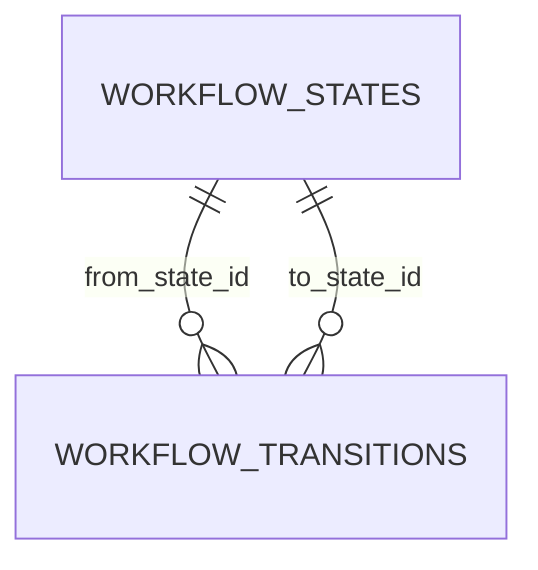
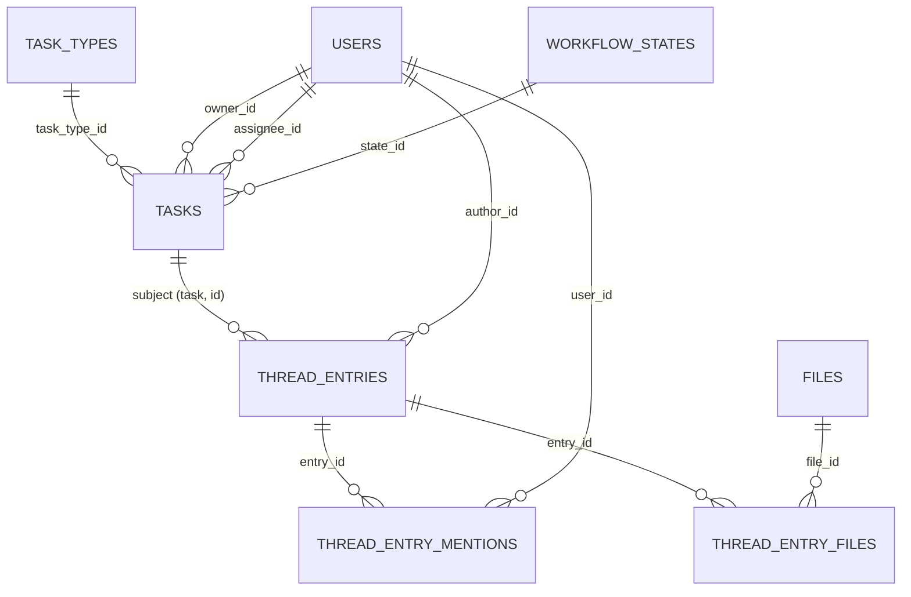
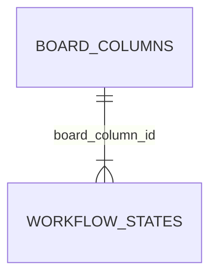

# ERD — Hito 3: tareas, tickets y cierre del legacy

**Estado:** se detalla por rebanada; hoy la 3.1 (motor de estados), la 3.2 (fotos), la 3.3 (tareas e hilo) y la 3.3d (columnas del tablero) · Fecha: 2026-11-14

Se completa con cada rebanada del Hito 3 (archivos, hilo, notificaciones, tareas y tickets). Decisiones: [ADR-0026](../../adr/0026-flujos-de-estado.md), [ADR-0027](../../adr/0027-fotos-subidas-y-su-acceso.md) y [ADR-0029](../../adr/0029-tareas-e-hilo-de-actividad.md) y [ADR-0030](../../adr/0030-columnas-del-tablero.md). Convenciones: [README](README.md).

## 3.1 Motor de estados

El flujo (`task`, `ticket`) es un código de la aplicación, no una tabla.

### `workflow_states`

| Columna | Tipo | Notas |
|---|---|---|
| `workflow_code` | `VARCHAR(30) NOT NULL` | `task` o `ticket` |
| `name` | `VARCHAR(100) NOT NULL` | Único entre los activos del flujo: `uq_workflow_states_active_name (workflow_code, active_name)` |
| `active_name` | generada | `IF(deleted_at IS NULL, name, NULL)` |
| `color` | `CHAR(7) NOT NULL` | `#RRGGBB` en mayúsculas |
| `sort_order` | `INT UNSIGNED NOT NULL` | Posición en el flujo; la lista sale ordenada por ella |
| `is_initial` | `TINYINT(1) NOT NULL` | Con qué estado nace un registro |
| `is_terminal` | `TINYINT(1) NOT NULL` | Alcanzarlo cierra el registro |
| `initial_marker` | generada | `workflow_code` si es inicial y activo, si no `NULL`; `uq_workflow_states_initial` deja un solo inicial activo por flujo |

Más los campos de toda tabla de negocio (`id`, `created_at`, `updated_at`, `version`, `deleted_at`).

### `workflow_transitions`

`from_state_id` y `to_state_id` (`BINARY(16)`, FK a `workflow_states`), clave primaria compuesta. Es configuración que la pantalla reemplaza como conjunto, como `role_permissions`: no lleva campos de sincronización.

### Reglas que el índice no cubre (las aplica `WorkflowStateService` con el flujo bloqueado)

- Al menos un estado final activo: no se desactiva el último ni se le quita la bandera.
- El estado inicial no se desactiva ni es final; la bandera se mueve marcando otro estado.
- Una transición une dos estados activos del mismo flujo, distintos entre sí y sin repetirse. Las que tocan un estado inactivo se conservan al reemplazar el conjunto.

### Siembra

- **Tareas:** Asignada (inicial) → Aceptada o Rechazada; Aceptada → En ejecución; En ejecución → Completada; Completada → Cerrada (final) o En ejecución; Rechazada → Asignada.
- **Tickets:** Abierto (inicial) → En atención → Resuelto → Cerrado (final); Resuelto → En atención.

Recurso de permisos `workflow_states` (ver, crear, editar, desactivar), sin alcance; `admin` lo recibe completo.

## 3.2 Archivos y fotos

### `files`

| Columna | Tipo | Notas |
|---|---|---|
| `uploaded_by` | `BINARY(16) NOT NULL` | FK `users`; es el dueño y lo que sigue el alcance del recurso |
| `original_name` | `VARCHAR(190) NOT NULL` | El nombre que dio el cliente, solo para mostrarlo; sin ruta ni caracteres de control |
| `width`, `height` | `INT UNSIGNED NOT NULL` | Píxeles de la imagen normal |
| `size_bytes` | `INT UNSIGNED NOT NULL` | Bytes de la imagen normal |
| `content_hash` | `CHAR(40) NOT NULL` | `sha1` de la imagen normal; distingue un reintento de otra foto con el mismo id, y es el `ETag` |
| `normal_path`, `thumbnail_path` | `VARCHAR(190) NOT NULL` | Rutas relativas a `storage/`, de la forma `files/<2 hex>/<id>-normal.webp`; nunca salen por la API |
| `metadata` | `JSON NULL` | `taken_at`, `latitude`, `longitude`, `device_make`, `device_model`; solo lo que llegó y era válido |

Más los campos de toda tabla de negocio. El id lo elige el cliente (UUID v7), así que la tabla puede llenarse sin conexión.

Recurso de permisos `files` (ver, crear, editar, desactivar) con alcance; `admin` lo recibe completo con `all`. No lleva columnas de adopción: cuando un registro adopte fotos, lo hará con su propia tabla de unión o su propia columna, y quien ve el registro verá sus fotos (ADR-0027).

## 3.3 Tareas e hilo de actividad

### `task_types`
Parámetro del catálogo (misma forma que `payment_methods`: nombre único entre activos, sembrado con los nueve tipos de AP1: Ventas, Compras, Administrativa, Mantenimiento, Emergencia, Proyecto, Cobro, Pago y Servicios). Recurso de permisos `task_types`, con lista de opciones abierta a toda sesión interna.

### `tasks`

| Columna | Tipo | Notas |
|---|---|---|
| `title` | `VARCHAR(150) NOT NULL` | |
| `description` | `TEXT NULL` | Hasta 5000 caracteres |
| `task_type_id` | `BINARY(16) NOT NULL` | FK `task_types`; uno inactivo se acepta solo si la tarea ya lo tenía |
| `owner_id` | `BINARY(16) NOT NULL` | FK `users`; quien la creó |
| `assignee_id` | `BINARY(16) NOT NULL` | FK `users`; usuario interno activo; puede ser el mismo dueño (una tarea para dar seguimiento uno mismo) |
| `due_date` | `DATE NOT NULL` | Solo fecha; la hora queda para después |
| `state_id` | `BINARY(16) NOT NULL` | FK `workflow_states` (flujo `task`) |
| `proposed_due_date` | `DATE NULL` | La fecha que propone el asignado al devolver la tarea; se limpia en el siguiente paso |

Más los campos de toda tabla de negocio. Recurso `tasks` con alcance: la alcanzan su dueño, su asignado y quien fue mencionado en un comentario activo sin necesitar permiso alguno; `tasks.view` con su alcance (que mira ambas columnas) solo ensancha eso.

### `thread_entries`

| Columna | Tipo | Notas |
|---|---|---|
| `seq` | `BIGINT UNSIGNED AUTO_INCREMENT` | Desempata entradas del mismo milisegundo; el orden de lectura es `(created_at, seq)` |
| `subject_type`, `subject_id` | `VARCHAR(30)`, `BINARY(16)` | El registro del que cuelga (`task` hoy, `ticket` en 3.5); sin FK |
| `kind` | `VARCHAR(10) NOT NULL` | `comment` o `event` |
| `author_id` | `BINARY(16) NOT NULL` | FK `users`; en un evento, quien hizo el cambio |
| `body` | `TEXT NULL` | Con menciones como `@[id]`; nulo en un evento o en un comentario solo de fotos |
| `event_type`, `event_data` | `VARCHAR(40)`, `JSON` | `created`, `state_changed`, `assignee_changed`, `due_date_changed` |
| `visibility` | `VARCHAR(10) NOT NULL` | `internal` hoy; el portal (Hito 9) leerá solo `external` |
| `edited_at` | `DATETIME(3) NULL` | Marca «editado» |

Más los campos de toda tabla de negocio. `thread_entry_mentions (entry_id, user_id)` y `thread_entry_files (entry_id, file_id, sort_order)` son uniones de clave compuesta. Recurso `thread_entries` (ver, crear, editar, desactivar), sin alcance propio: ver el hilo exige ver el registro.

## 3.3d Columnas del tablero

### `board_columns`

| Columna | Tipo | Notas |
|---|---|---|
| `workflow_code` | `VARCHAR(30) NOT NULL` | `task` o `ticket`, como `workflow_states` |
| `name` | `VARCHAR(100) NOT NULL` | Sin índice único: un estado inactivo puede repetir el nombre de uno activo, y el reemplazo del conjunto valida los nombres de las columnas activas |
| `sort_order` | `INT UNSIGNED NOT NULL` | Posición en el tablero |

Más los campos de toda tabla de negocio. `workflow_states.board_column_id` (`BINARY(16) NOT NULL`, FK) dice a qué columna pertenece cada estado, activo o no.

### Reglas que el esquema no cubre (las aplica `BoardColumnService` con el flujo bloqueado)

- Al reemplazar el conjunto, los estados activos aparecen exactamente una vez y cada columna lleva al menos uno y un nombre que no repite el de otra (sin distinguir mayúsculas).
- Una columna que queda sin ningún estado se cierra (`deleted_at`); una que solo conserva estados inactivos se conserva al final.
- El color de una columna es el de su primer estado activo; es «final» si alguno de sus estados es final.

### Siembra

La migración crea una columna por estado existente, con su nombre y su orden, y con el mismo id que el estado.
