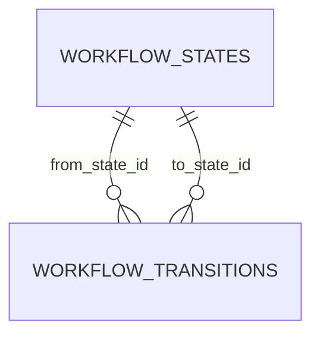

# ERD — Hito 3: tareas, tickets y cierre del legacy

**Estado:** se detalla por rebanada; hoy solo la 3.1 (motor de estados) · Fecha: 2026-10-30

Se completa con cada rebanada del Hito 3 (archivos, hilo, notificaciones, tareas y tickets). Decisión: [ADR-0026](../../adr/0026-flujos-de-estado.md). Convenciones: [README](README.md).

## 3.1 Motor de estados

El flujo (`task`, `ticket`) es un código de la aplicación, no una tabla.

### `workflow_states`

| Columna | Tipo | Notas |
|---|---|---|
| `workflow_code` | `VARCHAR(30) NOT NULL` | `task` o `ticket` |
| `name` | `VARCHAR(100) NOT NULL` | Único entre los activos del flujo: `uq_workflow_states_active_name (workflow_code, active_name)` |
| `active_name` | generada | `IF(deleted_at IS NULL, name, NULL)` |
| `color` | `CHAR(7) NOT NULL` | `#RRGGBB` en mayúsculas |
| `sort_order` | `INT UNSIGNED NOT NULL` | Posición en el flujo; la lista sale ordenada por ella |
| `is_initial` | `TINYINT(1) NOT NULL` | Con qué estado nace un registro |
| `is_terminal` | `TINYINT(1) NOT NULL` | Alcanzarlo cierra el registro |
| `initial_marker` | generada | `workflow_code` si es inicial y activo, si no `NULL`; `uq_workflow_states_initial` deja un solo inicial activo por flujo |

Más los campos de toda tabla de negocio (`id`, `created_at`, `updated_at`, `version`, `deleted_at`).

### `workflow_transitions`

`from_state_id` y `to_state_id` (`BINARY(16)`, FK a `workflow_states`), clave primaria compuesta. Es configuración que la pantalla reemplaza como conjunto, como `role_permissions`: no lleva campos de sincronización.

### Reglas que el índice no cubre (las aplica `WorkflowStateService` con el flujo bloqueado)

- Al menos un estado final activo: no se desactiva el último ni se le quita la bandera.
- El estado inicial no se desactiva ni es final; la bandera se mueve marcando otro estado.
- Una transición une dos estados activos del mismo flujo, distintos entre sí y sin repetirse. Las que tocan un estado inactivo se conservan al reemplazar el conjunto.

### Siembra

- **Tareas:** Asignada (inicial) → Aceptada o Rechazada; Aceptada → En ejecución; En ejecución → Completada; Completada → Cerrada (final) o En ejecución; Rechazada → Asignada.
- **Tickets:** Abierto (inicial) → En atención → Resuelto → Cerrado (final); Resuelto → En atención.

Recurso de permisos `workflow_states` (ver, crear, editar, desactivar), sin alcance; `admin` lo recibe completo.
