# ERD — convenciones y mapa

**Entregable 4 del Hito 0** · Estado: Hito 1 detallado; hitos 2 a 9 esbozados · Fecha: 2026-10-09

El modelo se detalla **hito por hito**: el Hito 1 ya está detallado; de los hitos 2 a 9 hay un esbozo de entidades y relaciones, y las columnas de cada uno se definen al planearlo.

| Documento | Contenido | Nivel |
|---|---|---|
| [`01-fundaciones.md`](01-fundaciones.md) | Hito 1: acceso, organización, configuración, márgenes, auditoría, dashboard | Detallado |
| [`02-esbozo-hitos-2-a-9.md`](02-esbozo-hitos-2-a-9.md) | Hitos 2 a 9: entidades, relaciones y las decisiones ya tomadas | Esbozo |

Decisiones que sustentan el modelo: [ADR-0015](../../adr/0015-identificadores-uuid.md) (identificadores) y [ADR-0016](../../adr/0016-catalogos-y-configuracion-tipados.md) (catálogos y configuración). Autenticación y permisos: [ADR-0012](../../adr/0012-autenticacion-y-autorizacion.md).

## Convenciones

**Nombres.** En inglés, `snake_case`, tablas en plural. Índices: `idx_<tabla>_<columnas>`, únicos `uq_<tabla>_<columnas>`, llaves foráneas `fk_<tabla>_<columna>`.

**Motor.** InnoDB, `utf8mb4` con `utf8mb4_unicode_ci`. MySQL 5.7 compatible con 8.0: sin `CHECK` (lo ignora), sin índices parciales ni funcionales; los límites se validan en el código.

**Clave primaria.** `id BINARY(16)`, UUID v7 generado por la aplicación (ADR-0015). Tablas de unión: clave compuesta de sus dos llaves. Tablas de sistema sembradas por migración (`resources`, `permissions`, `sequences`): `code` como clave natural.

**Campos de toda tabla de negocio** (se omiten en las tablas de cada módulo):

| Columna | Tipo | Uso |
|---|---|---|
| `id` | `BINARY(16)` | Clave primaria |
| `created_at` | `DATETIME(3) NOT NULL` | UTC |
| `updated_at` | `DATETIME(3) NOT NULL` | UTC; lo fija la aplicación con un reloj inyectado. Con índice: la sincronización lee `updated_at > since` |
| `version` | `INT UNSIGNED NOT NULL DEFAULT 1` | Se incrementa en cada cambio; detecta conflictos de edición, en web y en móvil |
| `deleted_at` | `DATETIME(3) NULL` | **Desactivación lógica**: nada se elimina (CLAUDE.md, sección 4). Activo ⇔ `NULL` |

Las tablas de unión, las de sistema, las de una sola fila de configuración con sus particularidades y los registros que solo se agregan (`audit_logs`, `refresh_tokens`, …) indican en su ficha qué campos llevan.

**Unicidad entre registros activos.** MySQL 5.7 no tiene índices parciales: se usa una columna generada `active_<campo> = IF(deleted_at IS NULL, <campo>, NULL)` con índice único (verificado en el servidor real con la lista de requisitos). Un valor desactivado se puede reutilizar.

**Llaves foráneas.** Siempre `ON DELETE RESTRICT` y `ON UPDATE RESTRICT`: como nada se borra, la base no debe permitirlo tampoco.

**Dinero y tasas.** Dinero `DECIMAL(14,2)`; costos y precios unitarios con la precisión que se defina en el Hito 2. Tasas y márgenes `DECIMAL(6,5)` (0.12000 = 12 %). Moneda en una columna `currency_code CHAR(3)` de los documentos monetarios (por defecto `GTQ`, P1).

**ENUM.** Solo para conjuntos cerrados que pertenecen al código (tipo de usuario, plataforma, alcance de datos). Lo que el administrador pueda ampliar (estados, catálogos) es una tabla.

**JSON.** Solo para datos sin estructura fija ni consultas por campo: valores antes/después de la auditoría y metadatos de archivos.

**Sincronización.** Toda tabla que pueda crearse sin conexión (Hito 3 y siguientes) lleva `id`, `updated_at`, `version` y `deleted_at` y se expone en `GET /sync?since=`. El Hito 1 no tiene tablas creadas offline, pero ya sigue las mismas reglas.

**Auditoría.** Todo cambio de datos de negocio escribe en `audit_logs` (usuario, acción, entidad, antes y después).

**Una sola fila.** Las tablas de configuración tienen `singleton ENUM('1') NOT NULL DEFAULT '1'` con índice único: la base impide una segunda fila.

## Mapa de entidades por hito

```mermaid
flowchart LR
    subgraph H1[Hito 1 — detallado]
        A[Acceso: users, roles, permisos, devices, tokens]
        O[Organización: departments]
        C[Configuración: company, financial, security, sequences]
        M[margin_levels]
        U[audit_logs, role_widgets]
    end
    subgraph H2[Hito 2 — esbozo]
        K[Catálogos PM1 a PM13]
        P[contacts, suppliers, products, bundles]
        L[clients]
    end
    subgraph H3[Hito 3 — esbozo]
        S[Motor de estados, hilo, notificaciones, archivos]
        T[tasks, tickets, importación legacy]
    end
    subgraph H49[Hitos 4 a 9 — esbozo]
        Q[Cotizador, proyectos, compras, inventarios, finanzas, móvil]
    end
    H1 --> H2 --> H3 --> H49
```

## Preguntas abiertas que afectan al modelo

| Pregunta | Supuesto con el que se modela | Si cambia |
|---|---|---|
| P5 Roles definitivos | Perfiles como datos: no hay roles fijos en el esquema | Solo cambian los datos sembrados |
| P20 Contraseñas del legacy | No se conoce el hash: `must_change_password` obliga a cambiarla en el primer acceso | Ninguna |
| P23 / P7 Esquema y datos del legacy | Se modela desde los requisitos; el usuario indica los campos que falten al revisar cada sección, y se agregan con una migración. El volcado del legacy es opcional. Columna `legacy_id` en las entidades importables (hitos 2 y 3) | Migración que ajusta columnas |
| P17 / P18 Paquetes | Sin descuento propio y sin paquetes anidados (Hito 2) | Migración |
| P2 Proyectos consolidados | Un proyecto puede tener subproyectos (Hito 5) | Migración |
