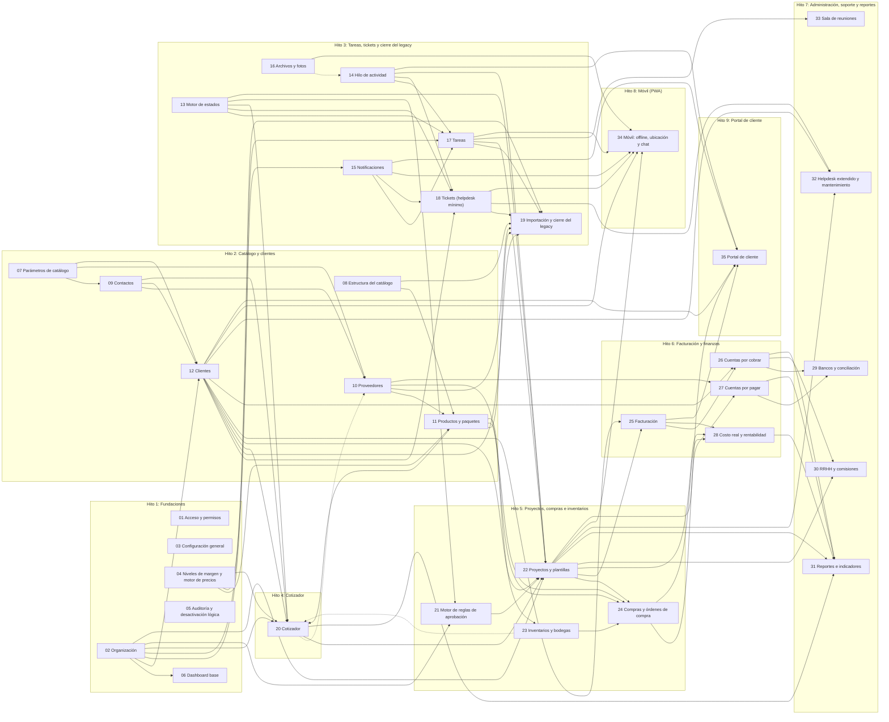

# Mapa de módulos y matriz de dependencias

**Entregable 1 del Hito 0** · Estado: borrador para revisión · Fecha: 2026-10-08

## 1. Qué cambia respecto a CLAUDE.md

Existe un sistema legacy con usuarios, perfiles, departamentos, configuración general (IVA, ISR, días de costo, niveles de margen), clientes, tickets, tareas y un catálogo de productos con proveedores, marcas, áreas y grupos. Decisión: **el sistema nuevo cubre primero lo que el legacy ya hace**, para poder apagarlo pronto y probar con datos reales; el Cotizador y el resto del plan original van después.

Por eso los hitos se re-secuencian. Se copian las funciones del legacy, no su diseño.

| Hito propuesto | Contenido | Hito original (CLAUDE.md) |
|---|---|---|
| 1 Fundaciones | Acceso, organización, configuración, márgenes, auditoría, dashboard base | 1 (sin tareas ni notificaciones) |
| 2 Catálogo y clientes | Parámetros, catálogo, proveedores, productos y paquetes, contactos, clientes | 2 |
| 3 Tareas, tickets y cierre del legacy | Motor de estados, hilo, notificaciones, archivos, tareas, tickets mínimos, importación del legacy | Parte del 1 (tareas, notificaciones) y nuevo (tickets, importación) |
| 4 Cotizador | Ofertas, plantillas, PDF, validez, congelamiento de precios | 3 |
| 5 Proyectos, compras e inventarios | Aprobaciones, proyectos, inventarios, compras | 4 |
| 6 Facturación y finanzas | Facturación, CXC, CXP, rentabilidad | 5 |
| 7 Administración, soporte y reportes | Bancos, RRHH, reportes, helpdesk extendido, sala de reuniones | 6 |
| 8 Móvil (PWA) | Offline, ubicación, chat | 7 |
| 9 Portal de cliente | Portal externo | 8 |

Dos movimientos explícitos: **tareas y notificaciones pasan del Hito 1 al 3**, porque nada las usa antes (el Hito 1 deja la infraestructura de acceso y el contenedor del dashboard), y el **motor de estados se construye una sola vez** en el Hito 3 y lo reutilizan tareas, tickets, cotizaciones y proyectos.
## 2. Inventario de módulos

Las dependencias duras (●) son las que obligan el orden de construcción. Las blandas (○) son mejoras que pueden esperar sin bloquear el módulo.

### Hito 1 — Fundaciones

| ID | Módulo | Contenido | Depende de | Depende de (blanda) |
|----|--------|-----------|------------|---------------------|
| 01 | Acceso y permisos | Usuarios internos y externos (clientes de la empresa, solo lectura), perfiles (roles) con permisos por módulo y acción, login con JWT y refresh revocable, recuperar contraseña, bloqueo por intentos, dispositivos | — | — |
| 02 | Organización | Departamentos, jefe directo (jerarquía), alcance de datos: propio, equipo, todo o solo el cliente asignado (usuarios externos) | 01 | — |
| 03 | Configuración general | Datos de la empresa, IVA, ISR, días para marcar un costo desactualizado, validez de cotización (15 días), correlativos, SMTP | 01 | — |
| 04 | Niveles de margen y motor de precios | Niveles de MC (uno por defecto) y fórmula de precio: costo con IVA → sin IVA → con IVA | 03 | — |
| 05 | Auditoría y desactivación lógica | Registro de usuario, acción, fecha y valores antes/después; activo/inactivo en lugar de borrar | 01 | — |
| 06 | Dashboard base | Contenedor y registro de widgets por perfil; cada hito agrega los suyos | 01, 02 | — |

### Hito 2 — Catálogo y clientes

| ID | Módulo | Contenido | Depende de | Depende de (blanda) |
|----|--------|-----------|------------|---------------------|
| 07 | Parámetros de catálogo | CRUD genérico: tipo de contacto, estado de cliente, segmentos, régimen fiscal, formas de pago | 01, 05 | — |
| 08 | Estructura del catálogo | Marcas, áreas y grupos (cada grupo pertenece a un área) | 01, 05 | — |
| 09 | Contactos | Personas con rol, asociadas a clientes o proveedores | 07 | — |
| 10 | Proveedores | Datos fiscales, contactos, crédito; al desactivar, desactiva sus productos | 07, 09, 05 | 20 |
| 11 | Productos y paquetes | Producto simple (costo con IVA, proveedor, área, grupo, marca) y paquete (productos × cantidad); precio calculado con el nivel de margen; alerta de costo desactualizado | 08, 10, 04, 03 | — |
| 12 | Clientes | Prospecto y venta, NIT sin duplicados, vendedor asignado, contactos; conversión manual hasta que exista el Cotizador | 07, 09, 02 | — |

### Hito 3 — Tareas, tickets y cierre del legacy

| ID | Módulo | Contenido | Depende de | Depende de (blanda) |
|----|--------|-----------|------------|---------------------|
| 13 | Motor de estados | Estados y transiciones configurables con banderas semánticas (p. ej. aceptada, terminal); un estado nuevo aplica solo a registros futuros | 01, 05 | — |
| 14 | Hilo de actividad | Comentarios, cambios de estado y menciones sobre cualquier registro; bandera interno/externo desde el inicio | 01 | 16 |
| 15 | Notificaciones | Configurables por perfil y departamento; en la aplicación y por email; endpoint de actualizaciones para el polling | 01, 02, 03 | — |
| 16 | Archivos y fotos | Almacenamiento local, compresión, WebP normal y miniatura, metadatos en JSON | 01 | — |
| 17 | Tareas | Lista de pendientes: asignada a alguien, estado, fecha de vencimiento, hilo | 01, 02, 13, 14, 15 | — |
| 18 | Tickets (helpdesk mínimo) | Cliente, asignado, estado, descripción e hilo; los campos extendidos se agregan después con migraciones | 12, 13, 14, 15 | — |
| 19 | Importación y cierre del legacy | Importadores (corrigen la codificación) de usuarios, configuración, márgenes, catálogo, proveedores, clientes, tareas y tickets; prueba paralela y apagado del legacy | 01, 03, 04, 08, 10, 11, 12, 17, 18 | — |

### Hito 4 — Cotizador

| ID | Módulo | Contenido | Depende de | Depende de (blanda) |
|----|--------|-----------|------------|---------------------|
| 20 | Cotizador | Ofertas y plantillas, estados configurables, validez de 15 días, precios y composición congelados, PDF, versiones, conversión prospecto → cliente al aceptar | 11, 12, 04, 03, 13, 09, 02 | 23 |

### Hito 5 — Proyectos, compras e inventarios

| ID | Módulo | Contenido | Depende de | Depende de (blanda) |
|----|--------|-----------|------------|---------------------|
| 21 | Motor de reglas de aprobación | Reglas configurables (monto, cliente nuevo, anticipo, perfil) y aprobador | 13, 02, 03 | — |
| 22 | Proyectos y plantillas | Plantillas de tipo de proyecto (etapas y actividades ponderadas), conversión oferta → proyecto, avance ponderado | 20, 12, 13, 17, 21, 14, 02 | — |
| 23 | Inventarios y bodegas | Bodegas, saldos y movimientos | 11, 05 | — |
| 24 | Compras y órdenes de compra | Solicitud con paquetes desglosados, comparación bodega/ofertado/solicitado, OC en PDF por proveedor | 22, 23, 10, 11, 03 | — |

### Hito 6 — Facturación y finanzas

| ID | Módulo | Contenido | Depende de | Depende de (blanda) |
|----|--------|-----------|------------|---------------------|
| 25 | Facturación | Facturación flexible por etapa; FEL si aplica | 22, 12, 03 | — |
| 26 | Cuentas por cobrar | Cobros, anticipos, cobros parciales, vencimientos | 25, 12 | — |
| 27 | Cuentas por pagar | Seguimiento por proveedor y antigüedad de saldos | 24, 10 | — |
| 28 | Costo real y rentabilidad | Costo real por proyecto y rentabilidad | 22, 24, 25 | — |

### Hito 7 — Administración, soporte y reportes

| ID | Módulo | Contenido | Depende de | Depende de (blanda) |
|----|--------|-----------|------------|---------------------|
| 29 | Bancos y conciliación | Cuentas, saldos y conciliación | 26, 27 | — |
| 30 | RRHH y comisiones | Empleados, prestaciones, motor de comisiones configurable | 01, 22, 26 | — |
| 31 | Reportes e indicadores | Pipeline, cobranza, ventas, márgenes y metas | 20, 22, 26, 27, 28 | — |
| 32 | Helpdesk extendido y mantenimiento | Equipos vendidos, contratos, SLA, prioridad y aviso de emergencias | 18, 22, 12 | — |
| 33 | Sala de reuniones | Proyectos internos y minutas | 17, 01 | — |

### Hito 8 — Móvil (PWA)

| ID | Módulo | Contenido | Depende de | Depende de (blanda) |
|----|--------|-----------|------------|---------------------|
| 34 | Móvil: offline, ubicación y chat | Sincronización con dispositivos, geolocalización, chat de proyecto | 01, 17, 18, 12, 16, 15, 22 | — |

### Hito 9 — Portal de cliente

| ID | Módulo | Contenido | Depende de | Depende de (blanda) |
|----|--------|-----------|------------|---------------------|
| 35 | Portal de cliente | Vista de lo propio, facturación, progreso y comunicación por proyecto | 12, 22, 25, 14, 15, 01 | — |

## 3. Diagrama de dependencias

Línea continua: dependencia dura. Línea punteada: dependencia blanda. Para que se lea, el diagrama omite las flechas hacia 01 Acceso y permisos, 03 Configuración general y 05 Auditoría, que casi todos los módulos usan; están completas en la matriz.

## 4. Matriz de dependencias

Cada fila es un módulo y cada columna un módulo del que depende (● dura, ○ blanda).

| Módulo \ requiere | 01 | 02 | 03 | 04 | 05 | 06 | 07 | 08 | 09 | 10 | 11 | 12 | 13 | 14 | 15 | 16 | 17 | 18 | 19 | 20 | 21 | 22 | 23 | 24 | 25 | 26 | 27 | 28 | 29 | 30 | 31 | 32 | 33 | 34 | 35 |
|---|---|---|---|---|---|---|---|---|---|---|---|---|---|---|---|---|---|---|---|---|---|---|---|---|---|---|---|---|---|---|---|---|---|---|---|
| 01 Acceso y permisos |  |  |  |  |  |  |  |  |  |  |  |  |  |  |  |  |  |  |  |  |  |  |  |  |  |  |  |  |  |  |  |  |  |  |  |
| 02 Organización | ● |  |  |  |  |  |  |  |  |  |  |  |  |  |  |  |  |  |  |  |  |  |  |  |  |  |  |  |  |  |  |  |  |  |  |
| 03 Configuración general | ● |  |  |  |  |  |  |  |  |  |  |  |  |  |  |  |  |  |  |  |  |  |  |  |  |  |  |  |  |  |  |  |  |  |  |
| 04 Niveles de margen y motor de precios |  |  | ● |  |  |  |  |  |  |  |  |  |  |  |  |  |  |  |  |  |  |  |  |  |  |  |  |  |  |  |  |  |  |  |  |
| 05 Auditoría y desactivación lógica | ● |  |  |  |  |  |  |  |  |  |  |  |  |  |  |  |  |  |  |  |  |  |  |  |  |  |  |  |  |  |  |  |  |  |  |
| 06 Dashboard base | ● | ● |  |  |  |  |  |  |  |  |  |  |  |  |  |  |  |  |  |  |  |  |  |  |  |  |  |  |  |  |  |  |  |  |  |
| 07 Parámetros de catálogo | ● |  |  |  | ● |  |  |  |  |  |  |  |  |  |  |  |  |  |  |  |  |  |  |  |  |  |  |  |  |  |  |  |  |  |  |
| 08 Estructura del catálogo | ● |  |  |  | ● |  |  |  |  |  |  |  |  |  |  |  |  |  |  |  |  |  |  |  |  |  |  |  |  |  |  |  |  |  |  |
| 09 Contactos |  |  |  |  |  |  | ● |  |  |  |  |  |  |  |  |  |  |  |  |  |  |  |  |  |  |  |  |  |  |  |  |  |  |  |  |
| 10 Proveedores |  |  |  |  | ● |  | ● |  | ● |  |  |  |  |  |  |  |  |  |  | ○ |  |  |  |  |  |  |  |  |  |  |  |  |  |  |  |
| 11 Productos y paquetes |  |  | ● | ● |  |  |  | ● |  | ● |  |  |  |  |  |  |  |  |  |  |  |  |  |  |  |  |  |  |  |  |  |  |  |  |  |
| 12 Clientes |  | ● |  |  |  |  | ● |  | ● |  |  |  |  |  |  |  |  |  |  |  |  |  |  |  |  |  |  |  |  |  |  |  |  |  |  |
| 13 Motor de estados | ● |  |  |  | ● |  |  |  |  |  |  |  |  |  |  |  |  |  |  |  |  |  |  |  |  |  |  |  |  |  |  |  |  |  |  |
| 14 Hilo de actividad | ● |  |  |  |  |  |  |  |  |  |  |  |  |  |  | ○ |  |  |  |  |  |  |  |  |  |  |  |  |  |  |  |  |  |  |  |
| 15 Notificaciones | ● | ● | ● |  |  |  |  |  |  |  |  |  |  |  |  |  |  |  |  |  |  |  |  |  |  |  |  |  |  |  |  |  |  |  |  |
| 16 Archivos y fotos | ● |  |  |  |  |  |  |  |  |  |  |  |  |  |  |  |  |  |  |  |  |  |  |  |  |  |  |  |  |  |  |  |  |  |  |
| 17 Tareas | ● | ● |  |  |  |  |  |  |  |  |  |  | ● | ● | ● |  |  |  |  |  |  |  |  |  |  |  |  |  |  |  |  |  |  |  |  |
| 18 Tickets (helpdesk mínimo) |  |  |  |  |  |  |  |  |  |  |  | ● | ● | ● | ● |  |  |  |  |  |  |  |  |  |  |  |  |  |  |  |  |  |  |  |  |
| 19 Importación y cierre del legacy | ● |  | ● | ● |  |  |  | ● |  | ● | ● | ● |  |  |  |  | ● | ● |  |  |  |  |  |  |  |  |  |  |  |  |  |  |  |  |  |
| 20 Cotizador |  | ● | ● | ● |  |  |  |  | ● |  | ● | ● | ● |  |  |  |  |  |  |  |  |  | ○ |  |  |  |  |  |  |  |  |  |  |  |  |
| 21 Motor de reglas de aprobación |  | ● | ● |  |  |  |  |  |  |  |  |  | ● |  |  |  |  |  |  |  |  |  |  |  |  |  |  |  |  |  |  |  |  |  |  |
| 22 Proyectos y plantillas |  | ● |  |  |  |  |  |  |  |  |  | ● | ● | ● |  |  | ● |  |  | ● | ● |  |  |  |  |  |  |  |  |  |  |  |  |  |  |
| 23 Inventarios y bodegas |  |  |  |  | ● |  |  |  |  |  | ● |  |  |  |  |  |  |  |  |  |  |  |  |  |  |  |  |  |  |  |  |  |  |  |  |
| 24 Compras y órdenes de compra |  |  | ● |  |  |  |  |  |  | ● | ● |  |  |  |  |  |  |  |  |  |  | ● | ● |  |  |  |  |  |  |  |  |  |  |  |  |
| 25 Facturación |  |  | ● |  |  |  |  |  |  |  |  | ● |  |  |  |  |  |  |  |  |  | ● |  |  |  |  |  |  |  |  |  |  |  |  |  |
| 26 Cuentas por cobrar |  |  |  |  |  |  |  |  |  |  |  | ● |  |  |  |  |  |  |  |  |  |  |  |  | ● |  |  |  |  |  |  |  |  |  |  |
| 27 Cuentas por pagar |  |  |  |  |  |  |  |  |  | ● |  |  |  |  |  |  |  |  |  |  |  |  |  | ● |  |  |  |  |  |  |  |  |  |  |  |
| 28 Costo real y rentabilidad |  |  |  |  |  |  |  |  |  |  |  |  |  |  |  |  |  |  |  |  |  | ● |  | ● | ● |  |  |  |  |  |  |  |  |  |  |
| 29 Bancos y conciliación |  |  |  |  |  |  |  |  |  |  |  |  |  |  |  |  |  |  |  |  |  |  |  |  |  | ● | ● |  |  |  |  |  |  |  |  |
| 30 RRHH y comisiones | ● |  |  |  |  |  |  |  |  |  |  |  |  |  |  |  |  |  |  |  |  | ● |  |  |  | ● |  |  |  |  |  |  |  |  |  |
| 31 Reportes e indicadores |  |  |  |  |  |  |  |  |  |  |  |  |  |  |  |  |  |  |  | ● |  | ● |  |  |  | ● | ● | ● |  |  |  |  |  |  |  |
| 32 Helpdesk extendido y mantenimiento |  |  |  |  |  |  |  |  |  |  |  | ● |  |  |  |  |  | ● |  |  |  | ● |  |  |  |  |  |  |  |  |  |  |  |  |  |
| 33 Sala de reuniones | ● |  |  |  |  |  |  |  |  |  |  |  |  |  |  |  | ● |  |  |  |  |  |  |  |  |  |  |  |  |  |  |  |  |  |  |
| 34 Móvil: offline, ubicación y chat | ● |  |  |  |  |  |  |  |  |  |  | ● |  |  | ● | ● | ● | ● |  |  |  | ● |  |  |  |  |  |  |  |  |  |  |  |  |  |
| 35 Portal de cliente | ● |  |  |  |  |  |  |  |  |  |  | ● |  | ● | ● |  |  |  |  |  |  | ● |  |  | ● |  |  |  |  |  |  |  |  |  |  |

## 5. Validación del orden

Resultado automático sobre 35 módulos: **ninguna dependencia dura apunta a un hito posterior y no hay ciclos.**

Dependencias blandas que van contra el orden (ver ajustes en la sección 6):

- 10 Proveedores → 20 Cotizador (hito 2 → hito 4)
- 20 Cotizador → 23 Inventarios y bodegas (hito 4 → hito 5)

## 6. Ajustes al orden y cómo se resuelven

1. **Alerta "sin existencia" (Cotizador, Hito 4) necesita saldos de inventario (Hito 5).** Hasta que exista Inventarios, el producto lleva una marca "validar disponibilidad" y la alerta se activa por esa marca. Cuando llegue el Hito 5, la alerta pasa a leer el saldo real.
2. **Cascada de proveedores hacia ofertas activas (Hito 2 → 4).** En el Hito 2 se desactivan los productos del proveedor; el aviso al responsable de una cotización vigente se implementa en el Hito 4, junto con el Cotizador.
3. **Tickets mínimos en el Hito 3, extendidos en el 7.** El ticket nace con los campos del legacy (cliente, asignado, estado, descripción, comentarios). Equipo, contrato, SLA, prioridad y canal de aviso se agregan después con migraciones aditivas, sin rehacer el módulo.
4. **Bandera interno/externo en el hilo desde el Hito 3**, aunque el portal sea del Hito 9, para no migrar comentarios después.
5. **Campos de sincronización (UUID, versión, borrado lógico) desde el primer esquema**, aunque el móvil sea del Hito 8. El endpoint de sync se implementa en el Hito 8.

## 7. Decisiones de negocio ya tomadas que afectan el diseño

- **Fórmula de precio:** `sin IVA = ((costo / (1 + IVA)) / (1 − MC)) / (1 − ISR)` y `con IVA = sin IVA × (1 + IVA)`. El costo del producto es **con IVA**. IVA, ISR y MC son parámetros (hoy 12%, 3% y los niveles del legacy). Ver [ADR-0011](adr/0011-calculo-de-precios.md).
- **Nivel de margen:** es habitual de cada cliente (opcional; sin él se usa el por defecto), se elige por línea al cotizar y se congela en la cotización emitida; no se guarda en el producto ni en el proveedor. En un paquete aplica a todos sus componentes.
- **Paquetes:** su precio es la suma de sus componentes, calculado en el momento. En la primera versión solo contienen productos simples.
- **Cotización:** tiene validez configurable (15 días). Los precios y la composición se congelan en la cotización. Una cotización nueva toma los precios vigentes. "Vigente" significa dentro de su validez.
- **Redondeo:** se calcula sin redondear; se redondea a 2 decimales al mostrar o cerrar una línea; el IVA se calcula sobre el total del documento.
- **Moneda:** quetzales (GTQ).
- **Usuarios externos:** los clientes de la empresa tendrán acceso limitado, solo para ver progreso y facturación, sin administrar. El modelo (tipo de usuario, cliente asignado, alcance por cliente) se define desde el ERD y el entregable de autenticación; las pantallas llegan con el Portal (Hito 9). Ver [ADR-0012](adr/0012-autenticacion-y-autorizacion.md).
- **Email:** SMTP autenticado. En desarrollo y pruebas, con un buzón creado en el cPanel y remitente en el dominio del hosting; `mail()` como plan B. Ver [ADR-0013](adr/0013-envio-de-email.md).
- **Tickets y tareas:** hilo de actividad por registro, tipo ticket de Jira. El chat libre entre usuarios queda para el Hito 8.

## 8. Preguntas nuevas (continúan la numeración de P1 a P16)

| # | Pregunta | Supuesto provisional | Confirmar antes de |
|---|----------|----------------------|--------------------|
| P17 | ¿Un paquete puede tener un descuento propio, distinto de la suma de sus componentes? | No | Hito 4 |
| P18 | ¿Un paquete puede contener otros paquetes? | No (solo productos simples) | Hito 4 |
| P19 | Al vencer una cotización, ¿cómo se renueva? | Se crea una nueva versión con los precios vigentes; la vencida queda como histórico | Hito 4 |
| P20 | Contraseñas del legacy: ¿se conoce el algoritmo de hash? | No; reseteo obligatorio en el primer acceso | Hito 3 |
| P21 | Campos extendidos del ticket (equipo, contrato, SLA, prioridad) y canal de aviso de emergencias | Fuera de la primera versión; aviso por polling y email | Hito 7 |
| P22 | ¿Basta el hilo por registro o el cliente quiere un chat libre entre usuarios? | Basta el hilo | Hito 8 |
| P23 | Migración del legacy: esquema real de la base de datos y datos a importar | Se obtiene un volcado de estructura al planear el Hito 3 | Hito 3 |
| P24 | Dominio remitente del correo en producción: ¿el de la organización (con un buzón que cree su administrador) o un dominio propio? | Dominio del hosting con buzón de cPanel; el de la organización se evalúa antes de producción | Antes de producción |

## 9. Siguiente paso

El orden de hitos fue aprobado y ya está en `CLAUDE.md` y `TODO.md`. Siguen, en este orden: estructura del repositorio, scaffolding (0B), ERD, esqueleto de autenticación y OpenAPI de los hitos 1 a 3.
